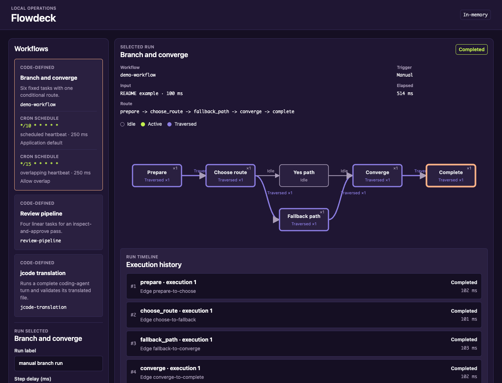

# Flowdeck

A local workflow cockpit for running, scheduling, and inspecting code-defined workflows. Flowdeck helps you launch runs, follow their progress, explore workflow topology, review recent history, and inspect results from a local web interface.

## Usage



Start Flowdeck through one of the setup options, then open <http://127.0.0.1:3000/>. Choose a bundled sample, enter its run arguments, and select **Run workflow**. Follow the highlighted route as the run progresses, then select a step or transition with a pointer, Enter, or Space to inspect its status, timing, output, and errors.

The bundled workflows demonstrate the interface only. Application developers define concrete workflows in Rust and rebuild Flowdeck to register them. Flowdeck is local and non-persistent, so run history remains available only while the application is running.

## Key features

- Run code-defined workflows from a local web interface.
- Use a workflow-specific input form to enter and validate each run's arguments.
- Define recurring schedules and their skip-or-overlap policy in Rust for runs that would start while an earlier run is still active.
- Automatically laid out SVG topology with external self-loop routing and active, traversed, selected, and execution-count states.
- Per-execution node and edge traces with timestamps, elapsed time, state, output, errors, and exact `StepId` history.
- Review recent runs and keep selected history filters in bookmarkable URLs.
- Navigate workflow details with a pointer or keyboard.
- Add optional coding-agent steps, with jcode as one example.

## All Code

Flowdeck follows an **All Code** approach. Workflow structure, schedules, inputs, validation, and execution rules are explicit Rust code. Define the workflow you need, rebuild Flowdeck, and review every change through normal version control.

Flowdeck deliberately provides no low-code or no-code workflow layer, visual workflow editor, or configuration DSL. Runtime values such as provider settings and credentials remain external inputs, but they do not define the workflow. With modern AI-assisted development, low-code and no-code representations offer no meaningful advantage in either version control or implementation cost, so Flowdeck keeps workflow definitions in Rust to maximize extensibility, compiler-checked correctness, and runtime performance.

## Prerequisites

- **Nix**: Install Nix with flakes enabled on `aarch64-darwin`, `aarch64-linux`, or `x86_64-linux` to run or install the packaged application.

## Setup

### Run without installing

```bash
nix run github:totto2727-org/flowdeck
```

### Install

```bash
nix profile add github:totto2727-org/flowdeck
```

### Nix flake

```nix
{
  inputs.flowdeck.url = "github:totto2727-org/flowdeck";

  outputs = { flowdeck, ... }: {
    packages = flowdeck.packages;
  };
}
```

## Optional coding-agent setup

Only workflows that use the optional jcode integration need this setup. Install the revision validated by Flowdeck:

```bash
cargo install --git https://github.com/1jehuang/jcode --rev a63dbc4546895ecb4d1be1a285d98e6e13fb1b74 --locked jcode
```

Set `JCODE_BIN` to the installed executable.
Flowdeck reads the active OpenAI-compatible provider through the independent [llm-profiles crate](https://github.com/totto2727-org/llm-profiles/tree/d3b3ede46fd823fe400aad85217537799b3ed40f).
Create `~/.agents/config.toml`:

```toml
active_provider = "translation"

[providers.translation]
base_url = "https://api.openai.com/v1"
model = "gpt-4.1-mini"
credential = "openai"

# Optional fixed and session-specific headers:
# [providers.translation.headers]
# User-Agent = "flowdeck"
# x-opencode-session = "${session_id}"

# Optional additional JSON request fields supported by your provider:
# [providers.translation.request_parameters]
# reasoning_effort = "low"
```

Place the matching key in `~/.agents/credentials.toml`:

```toml
[credentials.openai]
api_key = "replace-me"
```

Replace the placeholder before running the workflow and never commit credentials.
`AGENTS_CONFIG=/absolute/path/config.toml` selects another configuration file and its sibling `credentials.toml`.
Relative overrides are rejected, and the working directory and XDG directories are never searched for provider settings.
The shared loader validates every configured provider and restricts credential-file permissions to `0600` on Unix.
Flowdeck only loads existing files; it does not create templates or migrate settings automatically.

When migrating from the former GlossShift setup, move only the provider entries (`active_provider`, `providers.<name>`) and their referenced `credentials.<name>.api_key` entries to these shared files.
Leave application-specific settings in their owning application.
Flowdeck no longer reads or falls back to GlossShift configuration.
Each translation run loads a fresh configuration snapshot and starts its own private jcode process.
This adds process startup per run, but keeps provider headers and credentials consistent and isolates concurrent sessions.

The jcode adapter forwards the selected URL, model, API key, and `request_parameters` through its existing OpenAI-compatible transport.
Provider names are unrestricted.
A generated `flowdeck-shared` named profile pins the exact model and loopback endpoint instead of relying on jcode's built-in provider/model inference.
That profile lives in a run-private temporary jcode home and contains no upstream URL, credentials, headers, or request parameters.
The pinned jcode transport cannot attach arbitrary headers, so Flowdeck owns a small run-local bridge on `127.0.0.1` with a random local bearer token.
The bridge forwards only `POST /v1/chat/completions` to the configured provider's `/chat/completions` endpoint, disables redirects, and streams responses without buffering the full output.
Fixed `headers` are preserved and `${session_id}` is expanded with the actual SDK session ID immediately before the turn.
Requests before session binding are refused, and a bridge cannot be rebound to a different session.
The upstream API key is not passed to the jcode child process.

A private run resource store releases the process after the turn, while run completion, failure, or cancellation shuts down the bridge and requests SDK session cancellation.
An in-flight blocking SDK operation can retain the process until it returns or reaches the existing one-minute SDK request timeout.
Shared `first_chunk_timeout_seconds` (default 30) bounds the wait for response headers and the first body chunk, while `stream_idle_timeout_seconds` (default 60) bounds subsequent chunk waits.
These measure HTTP chunks, not model tokens, and do not replace the workflow or SDK request deadlines.
Flowdeck does not use Rig, so the optional Rig integration is not enabled.

## API

Flowdeck currently exposes its supported interface through the local web application. It does not publish a stable external API.

## Development

For repository structure and development commands, see [AGENTS.md](./AGENTS.md).
`just ci` includes synthetic configuration and loopback bridge regressions without accessing home settings or launching jcode.
After installing the pinned jcode binary, `just test-jcode-provider` exercises the real SDK and private process against a synthetic loopback provider under an isolated home and cleared environment.
On macOS, that test additionally uses `sandbox-exec` to permit only loopback and Unix-socket outbound connections.
Set `FLOWDECK_JCODE_TEST_BIN` to override the default `.tools/jcode/bin/jcode` path for that optional test.

## License

MIT

_This README was generated from the [share-artifact skill](https://raw.githubusercontent.com/totto2727-org/agent/refs/heads/main/plugins/totto2727-coding/skills/share-artifact/SKILL.md) and [README template](https://raw.githubusercontent.com/totto2727-org/agent/refs/heads/main/plugins/totto2727-coding/skills/share-artifact/readme/template.md)._
