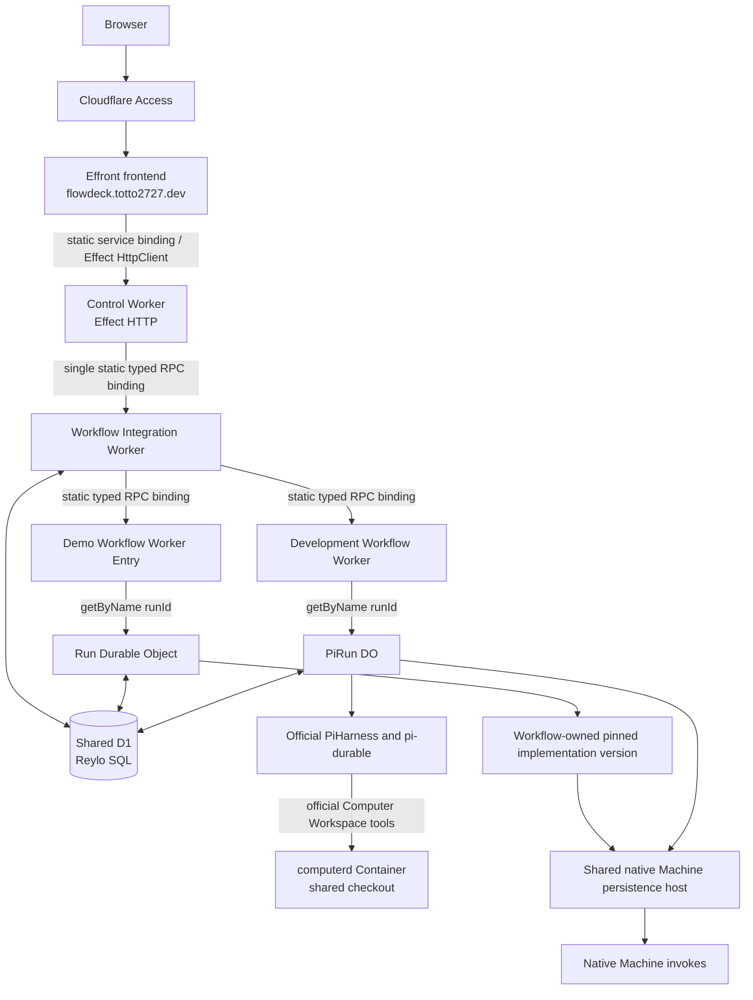
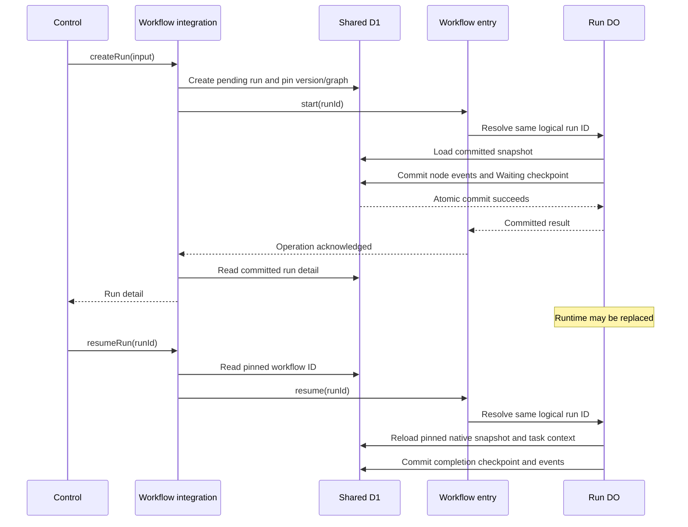

# Architecture

This document serves contributors and maintainers.
It implements the direction in the Flowdeck design dated 2026-10-17.
The current application is a local vertical-slice experiment, not a deployed service.

## Resource boundaries

All Workers, the D1 database, and the workspace Container belong to the `flowdeck` Alchemy project.
Each workflow has one Worker.
An additional integration Worker owns the catalog and fixed bindings to those workflow Workers.
The entry routes a run ID to one logical Durable Object ID.
The application does not depend on the lifetime of a JavaScript object instance.
Control and workflow Workers have no public domain, `workers.dev` endpoint, or preview endpoint.
The frontend is the only public entry point.
Development binds local ports 4380 through 4384 to loopback.

## Responsibilities

| Component               | Responsibility                                                                                   |
| ----------------------- | ------------------------------------------------------------------------------------------------ |
| Frontend                | Render shared shapes, inspect committed state and events, start and resume runs.                 |
| Control API             | Validate HTTP input, reject browser-originated mutations, and call one workflow service binding. |
| Workflow integration    | Expose the catalog and run operations, persist new runs, and select fixed workflow bindings.     |
| Workflow entry          | Resolve the run DO and forward typed operations.                                                 |
| Run DO                  | Load committed state and invoke the pinned workflow implementation.                              |
| Workflow implementation | Declare versioned native states, invokes, routing, and external-operation reconciliation.        |
| Shared foundation       | Derive graphs, restore native Machine execution, and commit checkpoints before ACK.              |
| Shared DB               | Store workflow versions, immutable graphs, runs, snapshots, ordered events, and commit receipts. |

Keep workflow registration and static bindings at the application composition boundary rather than introducing dynamic workflow discovery or dynamic service binding lookup.
The native Machine owns task progression and invoke execution.
The shared persistence host owns canonical snapshot validation, D1 commits, ACK handling, and observation hooks.
Workflow-owned invokes acquire runtime resources and reconcile external effects through an execution-scoped ResourceStore.
Do not add a competing transition interpreter or shared artifact store.

Core Worker entry points and Worker-specific features live under `src/core/worker/<worker>/`.
Workflow-owned entries and features live under `src/user-land/workflow/<workflow>/`.
The integration Worker entry is `src/bridge/workflow/bridge/worker.ts`.
Shared workflow schemas, graph projection, native execution persistence, and volatile ResourceStore live under `src/core/feature/workflow/`.
Reusable Alchemy D1 execution lives under `src/core/feature/d1/`, without workflow errors, SQL statements, or Worker resource declarations.
Opt-in official ClusterMachine checkpoint storage lives under `src/core/feature/cluster/`; it is independent from ordinary Machine workflows and does not provide durable Cluster messaging.
See [ClusterMachine D1 storage](cluster-machine-storage.md) for composition and transaction limits.
The fixed workflow RPC protocol lives under `src/core/feature/workflow/rpc/`; it is an application protocol, not a general-purpose RPC framework.

| Owner                               | Contents                                                                                        | Dependency boundary                                                          |
| ----------------------------------- | ----------------------------------------------------------------------------------------------- | ---------------------------------------------------------------------------- |
| `share/feature/identity`            | Reusable identifier schema and generation                                                       | Effect only; each capability owns its concrete identifiers.                  |
| `core/feature/d1`                   | Captured Alchemy client, Reylo executor, statement preparation, and prepared batch execution    | No workflow policy or application resources.                                 |
| `core/feature/cluster`              | Official ClusterMachine checkpoint storage, request receipts, codecs, and typed SQL             | Uses shared D1 execution, not workflow policy or application resources.      |
| `core/feature/workflow/domain`      | Workflow values, identities, rejections, and graph projections                                  | No persistence implementation or RPC error types.                            |
| `core/feature/workflow/services`    | Store and workflow ports, D1 persistence, SQL, and application failure aggregation              | Storage conflict interpretation stays here, above the D1 capability.         |
| `core/feature/workflow/rpc`         | Wire codecs, RFC 9457 profile, response sanitization, and SDK-call admission                    | Uses workflow domain contracts, not D1 or concrete workflow implementations. |
| `core/feature/workflow`             | Native Machine persistence host and volatile ResourceStore                                      | Uses the Store port, not its D1 implementation.                              |
| `core/feature/pi`                   | Pi command and receipt schemas, `PiSandbox`, and reusable node operations                       | No workflow node names, prompts, or transitions.                             |
| `core/worker/pi`                    | `PiSdk`, `makePiSdk`, `PiRun`, `PiContainer`, model provider, Workspace tools, and SDK adapters | No concrete workflow imports.                                                |
| `core/worker/<worker>`              | Frontend, Control, and database resources and behavior                                          | Uses core, share, and the bridge's neutral core contract.                    |
| `user-land/workflow/<workflow>`     | Input schemas, versions, machines, prompts, catalog definitions, and Worker assembly            | May import core and share.                                                   |
| `bridge/workflow/core`              | Neutral Worker identity, run operations, database runtime, and RPC handlers                     | Cannot import user-land or the bridge's assembly side.                       |
| `bridge/workflow/user-land/feature` | Installed definitions, static RPC bindings, and binding environment                             | Owns workflow-specific registration edits.                                   |
| `bridge/workflow/bridge`            | Final integration Worker assembly                                                               | Connects the core and user-land sides.                                       |
| `user-land/application.ts`          | Installed Worker implementation Layer graph                                                     | Composes core and workflow implementations.                                  |
| `user-land/resources.ts`            | Deployment resource list                                                                        | Re-exported by the thin `alchemy.ts` entry.                                  |

Core never imports user-land, including in tests, type-only imports, dynamic imports, and re-exports.
Core imports only the neutral `core` side of a Worker bridge, never its `user-land` or `bridge` side.
Share imports neither core nor bridge nor user-land.
The Workflow bridge provides installed workflow functionality to Control through the neutral wire contract.
Registration enters the integration runtime through Layer composition, not a core import of the installed workflow list.
Adding a workflow requires no core edit.
See [Add a workflow](add-workflow.md) for the edit checklist.

The development machine owns `implement` and `verify`, their prompts, and their run and node events.
Shared Pi operations do not choose those nodes or infer when the run starts or finishes.
`PiSdk` and Workspace capabilities remain in the run Durable Object, not a separate shared Pi Worker.
The TypeScript `PiRun` identity retains the native binding name `DevelopmentRun`.
`PiContainer` retains the infrastructure resource name `JcodeSandbox`.
The official root session remains `ROOT_SESSION = '1'`, scoped to each run Durable Object.

`WorkflowFailure` aggregates application failures in `services/failures.ts`; the domain error constructors do not import transport types.
The HTTP failure-logging middleware remains one shared module because another service or feature abstraction adds no capability.
The [feature-boundary tests](../tests/feature-boundaries.test.ts) parse TypeScript and TSX imports with the installed TypeScript compiler.
They enforce ownership and feature boundaries, including tests, type-only imports, dynamic imports, and re-exports.
Cross-layer workflow tests live in `tests/integration/d1-workflows.test.ts`, `operation-logging.test.ts`, and `demo-projection.test.ts`, not in core.
Keep the SQL statements and persistence codecs with workflow storage rather than moving all database-adjacent code into D1.
The shared `Workflows` service is Control's only workflow dependency.
The application follows modular-monolith boundaries: each workflow is an independent application module behind a shared interface.
Workflow IDs, supported versions, input validation, native machine declarations, task adapters, and initial context live under `src/user-land/workflow/<workflow>/feature/`.
Versioned demo definitions live in `version-1.ts` and `version-2.ts`, while development declares its topology in `development-machine.ts`.
`src/core/feature/workflow/services/workflow-definition.ts` defines only the neutral definition, executor, and registry contracts.
`src/bridge/workflow/user-land/feature/registration.ts` combines the workflow-provided definitions and fixed execution bindings into an array.
Its sibling `workflow-binding.ts` declares Context services.
`environment.ts` declares fixed Worker bindings and their typed RPC adapters.
The integration service uses registry lookup for catalog, create, and resume operations without branching on workflow IDs.
The frontend renders version choices and input descriptors from the catalog without importing workflow implementations.
The shared create schema validates only the routing envelope and semantic version format; the selected definition validates all workflow-specific fields before persistence or dispatch.
Workflow versions are official Effect `SemVer` values in the domain, not a shared version enumeration.
HTTP, Worker RPC, and D1 adapters use official Schema codecs to encode strings and decode domain values.
Serializing a domain object directly is not a substitute for those codecs.
Adding a workflow requires its typed input schema, implementation, and integration registration, but no new Control binding.
An unknown persisted workflow ID is rejected rather than sent to the demo worker.
The final composition boundary in `src/user-land/composition.ts` selects deployment and authorization Layers.
`src/user-land/application.ts` assembles the complete installed Worker graph.
`src/core/worker/frontend/runtime-composition.ts` captures only the fixed frontend runtime and does not import that deployment graph.
The frontend always invokes the injected authorization service before dispatch.
The Access implementation verifies trusted platform admission and the configured audience, and never checks a development flag.
Local composition injects Alchemy's fixed development Access simulation, not a fallback inside authorization logic.
Feature logic does not inspect deployment stages, infrastructure phases, or development flags.

## Effect and interoperability

Application logic uses Effect services, Layers, schemas, collections, Match, and HTTP APIs.
External storage and service failures use `ExternalError` with required operation, cause, and kind fields.
Domain rejections such as `Conflict` and `InvalidSnapshot` have no optional cause field.
The HTTP boundary returns safe messages rather than external causes, retaining 500 for storage failures and 502 for service failures.
State-dependent fields belong to explicit tagged variants; optional properties are reserved for genuinely optional metadata.
Atlas HCL defines SQLite tables, checks, foreign keys, and indexes.
Reylo Content Mapper infers query input and result types directly from the local HCL schema.
`D1StoreLive` obtains Alchemy's Effect-native database client through Context and Layer composition.
Reylo supplies checked SQL and parameter encoding; Alchemy owns prepared statement execution and atomic batches.
D1 `batch` provides atomic receipt, checkpoint, and event writes; independent query calls do not provide that transaction.
See [database workflow](database.md) for schema generation, migration ownership, and the narrow upstream binding patch.
The frontend adapts the native static binding to the Fetch implementation consumed by Effect HttpClient.
Native Request construction exists only in that adapter.
Alchemy owns native Worker HTTP and typed RPC bridges.
Application RPC methods exchange Schema-validated JSON text, including successful values.
Each service logs its original failure locally with an error ID and sends only an [RFC 9457 problem](rpc-boundaries.md).
The parent creates a new local error with that problem as its cause; it does not reconstruct the child's exception or receive its stack.
React and Playwright remain framework boundaries.

### State-machine library and durable execution

Flowdeck selects [`@typeonce/effect-machine`](https://github.com/typeonce-dev/effect-machine), a schema-first community library for Effect.
The installed package is `0.46.0`, with peer dependency `effect: ^4.0.0`.
Effect core `4.0.6` does not contain the earlier experimental Machine API, so this is adoption of the separately published library, not an official core module.
XState and native Cloudflare Workflows are not the selected execution foundation.

The library's [planning and persistence contracts](https://github.com/typeonce-dev/effect-machine/blob/main/packages/effect-machine/README.md#persistence) distinguish logical state from a running machine process.
Pure planning computes state changes without executing command effects.
The application uses the pure initial plan only for pending run preparation, then executes ordinary native Machine.start and Machine.resume with explicit D1 checkpoints.
The library owns invoke execution and transitions, while D1 holds canonical serialized state rather than a process-local MachineRef.
See [Workflow graphs](workflow-graphs.md) for native execution, persistence, lifecycle hooks, and recovery contracts.
This integration does not establish exactly-once external side effects.

## Data and graph identity

`src/share/feature/identity/id.ts` separates caller-defined IDs from app-generated random IDs.
`UserDefinedId` accepts 1 to 128 ASCII letters, digits, underscores, or hyphens and rejects unsafe input instead of silently rewriting an identity.
`makePrefixedUUIDv4(prefix)` validates the configured prefix and returns `{ schema, make }`.
The schema uses official `Schema.TemplateLiteral` with `Schema.isUUID(4)` for the suffix.
The factory closes over that prefix and its decoder, created once, and returns `make` as an Effect value rather than a zero-argument function.
Use `yield* makeRunId` to generate an ID; each execution resolves the official Effect Crypto service from its current context.
The installed Effect 4.0.6 exposes UUID generation on `Crypto.Crypto`, not a module-level `Crypto.randomUUIDv4` accessor.
Tests can provide official `TestCrypto.layer(seed)` for reproducible UUID sequences without changing production code.
`PrefixedUUIDv4` and the concrete `RunId`, `ExecutionId`, `EventId`, `CommitId`, and `CommandId` types are inferred from their schemas and remain strings, without brands.
For example, `const { schema: RunId, make: makeRunId } = makePrefixedUUIDv4('run')` defines validation and generation together.
Shared workflow identities live in `src/core/feature/workflow/domain/identity.ts`; the shared Pi feature owns its command identity in `src/core/feature/pi/model.ts`.
The generic identity feature contains no ID-kind union, registry, or central generation dispatcher.
New app-owned IDs use `run_`, `execution_`, `event_`, `commit_`, or `command_` prefixes.
These prefixes describe origin, not authorization or creation time.

All application-owned ID fields use their named schemas, including persisted envelopes, workflow snapshots, HTTP input, graph definitions, and UI projections.
`WorkflowId`, `GraphId`, `NodeId`, and `EdgeId` use `UserDefinedId` because workflow implementations define them.
`RunId`, `EventId`, `ExecutionId`, `CommitId`, and development-owned `CommandId` require their exact prefix and UUIDv4 suffix.
Graph definitions use safe named references such as `demo-1_0_0-graph-1`, not unrestricted composite strings.
Malformed IDs, wrong prefixes, bare UUIDs, and UUIDv7 are rejected.
The application is unreleased and intentionally has no legacy-ID or legacy-version compatibility paths.
D1 validates run, graph, and commit schemas before writes, and validates decoded rows and acknowledgments on read.
Framework-owned Durable Object IDs, Pi's literal root-session ID `1`, tool-call IDs, provider model identifiers, and Cloudflare account/Gateway identifiers retain their official contracts rather than being rewritten as application UUIDs.
Run ordering uses the existing `created_at` index, and event ordering uses the indexed run/sequence columns.
Neither ordering path depends on lexical ID order or UUIDv7.

| Record           | Key data                                                                       |
| ---------------- | ------------------------------------------------------------------------------ |
| Workflow         | Workflow ID and display name.                                                  |
| Workflow version | Workflow ID, implementation version, graph ID.                                 |
| Graph            | Graph ID, schema version, graph JSON.                                          |
| Run              | Run ID, pinned version, immutable graph reference, status, revision.           |
| Run state        | Run ID, revision, snapshot.                                                    |
| Run event        | Event ID, run ID, ordered sequence, kind-specific execution identity, payload. |
| Commit receipt   | Commit ID, exact command, revision, first event sequence, event count.         |

The machine definition supplies the single topology source used for execution and graph derivation.
`src/core/feature/workflow/graph.ts` uses the selected library's compiled state nodes and transition definitions to construct `GraphDefinition`.
Workflow modules do not maintain a second visual edge list.
The graph JSON records that derived contract for the run, not executable tasks or a complete machine runtime.

The current graph IDs are explicit versioned identifiers, not content hashes.
A repeated identical graph is reused.
Database guards reject reuse of a graph ID with different content and prevent graph or version updates.
Change the graph ID and workflow version when a graph contract changes.
A node ID identifies a definition.
An execution ID and attempt identify an execution, including retries.
Graph-to-shape conversion and event projection use these identities independently from transient UI selection.
Node shapes group coordinates under `position: { x, y }` and dimensions under `size: { width, height }`.
Layout origin, horizontal step, and node size are named module-level constants in the projection file, not a separate constants module.

`RunEvent` is a discriminated union keyed by `type`.
Node lifecycle events and `run.waiting` require a node ID, execution ID, and positive attempt.
Other run lifecycle events do not carry those fields, and boundary decoders use the official `onExcessProperty: 'error'` option to reject them, including `null` placeholders.
SQL nullable columns are a persistence detail that the D1 adapter converts at its boundary, not a domain state representation.
Run and event timestamps are official `DateTime.Utc` values internally, with official JSON codecs and ISO formatting at persistence and transport boundaries.
Snapshots and event payloads use the shared official `Schema.JsonObject`, which permits nested JSON but rejects arrays or scalars as the root and rejects non-JSON nested values.
The persistence host validates and encodes the library logical snapshot and its workflow version.
Workflow domain data and operation identities belong to native State schemas.
Clients and other non-serializable values belong to a separate execution-scoped ResourceStore and never enter snapshots.
The routing envelope leaves workflow-specific input unknown until the selected workflow validates it, rather than importing workflow domain knowledge into the common interface.

## Commit and acknowledgment

1. Construct a typed transition command with an expected revision and a stable commit ID.
2. Bind the receipt, run update, snapshot update, and event insert SQL through Reylo.
3. Submit the statements in one D1 batch.
4. Reject a stale revision or a changed command that reuses a commit ID.
5. Return an acknowledgment only after the batch succeeds and the receipt is read.

The persistence host invokes registered lifecycle hooks after the D1 acknowledgment.
Hooks are best-effort observation: a failure does not roll back state, and a crash can occur after commit but before hook delivery.
No transactional hook outbox or replay guarantee is provided.
Workflow progression and external-operation reconciliation must not depend on an observational hook.

The revision guard executes inside the database transaction.
Duplicate event IDs within a command are rejected before the batch starts.
An event-ID collision in another commit aborts the complete batch.
An identical command can receive its previous receipt even after later revisions.
State and events therefore have one commit boundary.
Run detail reads use a revision-bounded event prefix so a newer transition cannot attach newer events to an older snapshot.
The shared DB is canonical for integration Worker and DO reads.
Atlas Pro generates SQL migrations from the HCL definitions in `schema/`.
Keep the generated SQL unchanged by default.
The undeployed application uses one initial migration.
After deployment, keep applied migrations immutable and generate new migrations for schema changes.

## Start and recovery

Control forwards creation to the integration Worker.
The integration Worker persists a new pending run, its version, and its graph before calling the selected workflow binding.
A binding failure must leave the pending run available for explicit recovery.
A DO call loads the last committed state instead of using a cached continuation.
The versioned envelope contains a single native snapshot, not a duplicate task position or context envelope.
Workflow identity, version, graph, native state, and derived status must agree.
Pending runs use ordinary Machine.start, while saved running or waiting checkpoints use Machine.resume.
The native library owns entering the next state and starting its invoke.
All workflow logic, including initialization, receipt checks, and completion, runs inside these invokes.
Invokes use WorkflowCheckpoint to persist the current native intent before external side effects.
The shared host does not choose or dispatch nodes.
Native resume can restart an active invoke, so stable execution and command identities must be reconciled rather than blindly replayed.
Completed and failed runs are terminal.

The demo reaches an inert approval state and waits for explicit Resume before native publishing.
The Pi workflow uses nested native states for submission, awaiting, receipt polling, verification, and completion.
A running receipt returns to the identical awaiting snapshot without a new revision, event, or submission.
Volatile ResourceStore values are shared within a command Scope and reacquired after disposal and resume.
The PiHarness DO remains responsible for its durable conversation and operations.
See [Workflow graphs](workflow-graphs.md) for the complete execution and recovery sequence.

DO replacement does not itself trigger execution.
The current recovery trigger is an explicit RPC through the resume operation.
Alarms, reconnecting runners, and environment-specific checkpoints are workflow extensions, not implied common guarantees.

## Frontend styling

Application components use Tailwind utilities and the local shadcn/ui components.
`src/core/worker/frontend/feature/styles/app.css` contains only Tailwind imports, shadcn theme mappings, and base configuration, not application selectors.
Graph canvas dimensions and node coordinates come from persisted graph projections at runtime.
These unbounded numeric values cannot be enumerated as statically discovered Tailwind classes, so the graph uses a documented inline geometry boundary while Tailwind controls its appearance, state, and interaction styling.
Each unavoidable nonstandard implementation must document its purpose, rejected standard alternatives, and exact scope beside the code before review.

## Version lifecycle

New runs explicitly select a semantic version advertised by their workflow definition.
The demo advertises `1.0.0` and `2.0.0`; the development workflow advertises `1.0.0`.
Each workflow validates only its current supported semantic versions at its restore boundary.
Existing runs restore their stored version rather than a mutable latest alias.
Keep old code while a pending, active, waiting, or recoverable run references it.
Remove an old implementation only after its resumable runs have reached a terminal state.
The retained graph, state, and events do not guarantee execution after code removal.
Dependency upgrades do not preserve an old runtime binary or complete historical reproducibility.
No code-removal automation exists in this experiment.

## Access and domain

The production hostname is `flowdeck.totto2727.dev`.
Production declares a self-hosted Cloudflare Access application and references the existing reusable SAML policy through `FLOWDECK_ACCESS_POLICY_ID`.
That policy is managed outside Flowdeck; this application does not create duplicate email allowlists or policy rules.
The runtime checks trusted native Access admission and its audience before handling any Effront request, including ServerFns.
Caller-supplied identity headers grant no access.
The private Control mutation routes reject browser Origin headers before parsing the body.
Browser mutations use authenticated Effront ServerFns, which call Control through the server-side binding.
A missing Access context returns 401, a wrong audience returns 403, and invalid audience configuration returns 503.
Only the local composition boundary injects the development Access simulation.
There is no public API token or browser-controlled bypass.
Control trusts the Worker that holds its service binding, rather than authenticating an end user again.
Every admitted frontend identity currently has access to the same runs.
There is no per-user ownership or per-run authorization model.
Private ingress restricts callers but does not replace user-level authorization if the application later adds separate user or tenant permissions.

Cloudflare resources are not deployed by local development.
Cloudflare credentials and account selection remain standard Alchemy inputs.
Do not add a deployment task or enable a cloud operation without operator authorization.
Production DNS, Access admission, and deployment behavior require a separate authorized cloud acceptance test.

## Remaining work

- Resolve the remaining PiHarness task acceptance and environment limits before deployment; see [development sandbox](development-sandbox.md).
- Establish production operating limits, retention, pagination, and old-version removal procedures before a larger deployment.
- Authorize and validate the real production domain and Access policy before release.

## Source references

- [Effect Machine library](https://github.com/typeonce-dev/effect-machine)
- [Effect Machine planning and snapshot API source](https://github.com/typeonce-dev/effect-machine/blob/main/packages/effect-machine/src/Machine.ts)
- [Effect Machine API reference](https://effect-machine.typeonce.dev)
- [Cloudflare service bindings](https://developers.cloudflare.com/workers/runtime-apis/bindings/service-bindings/)
- [Durable Object lifecycle](https://developers.cloudflare.com/durable-objects/concepts/durable-object-lifecycle/)
- [D1 atomic batch API](https://developers.cloudflare.com/d1/worker-api/d1-database/#batch)
- [Cloudflare Access for Workers](https://developers.cloudflare.com/cloudflare-one/access-controls/applications/non-http/cloudflare-workers/)
- [Reylo SQL Content Mapper](https://reylo.dev/#setup)
- [Atlas SQLite schema management](https://atlasgo.io/getting-started/)
- [Vite+ migration and toolchain overrides](https://viteplus.dev/guide/migrate)

The toolchain starts from `template/vite-plus-app` revision `f0b8dffb085518d10cd42729a10c11de08a1736b`.
The Effront, shadcn, and multi-Worker composition references come from Projektor revision `a8dae3d5c54b1eb67e2d7f4dd095584b309ced3a`.
