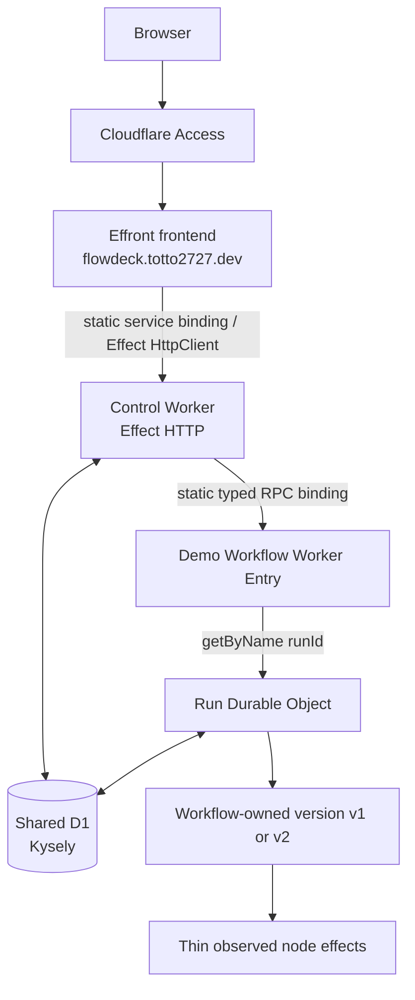
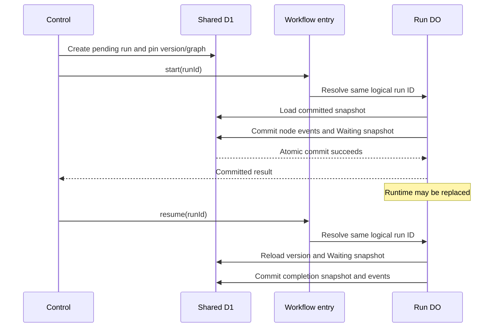

# Architecture

This document serves contributors and maintainers.
It implements the direction in the Flowdeck design dated 2026-10-17.
The current application is a local vertical-slice experiment, not a deployed service.

## Resource boundaries

All Workers and the D1 database belong to the `flowdeck` Alchemy project.
Each workflow has one Worker.
The entry routes a run ID to one logical Durable Object ID.
The application does not depend on the lifetime of a JavaScript object instance.
Control and workflow Workers have no public domain, `workers.dev` endpoint, or preview endpoint.
The frontend is the only public entry point.
Development binds local ports 4380, 4381, and 4382 to loopback.

## Responsibilities

| Component               | Responsibility                                                                                   |
| ----------------------- | ------------------------------------------------------------------------------------------------ |
| Frontend                | Render shared shapes, inspect committed state and events, start and resume runs.                 |
| Control API             | Validate HTTP input, create run records, read shared data, call static workflow bindings.        |
| Workflow entry          | Resolve the run DO and forward typed operations.                                                 |
| Run DO                  | Load committed state and invoke the pinned workflow implementation.                              |
| Workflow implementation | Define version-specific nodes, transitions, checkpoint interpretation, and recovery.             |
| Shared DB               | Store workflow versions, immutable graphs, runs, snapshots, ordered events, and commit receipts. |

Do not add dynamic workflow registration, dynamic dispatch, a common runner protocol, binary transfer, or a shared artifact store.
Runtime resources and side-effect recovery belong to the workflow that uses them.

## Effect and interoperability

Application logic uses Effect services, Layers, schemas, collections, Match, and HTTP APIs.
Kysely query builders remain typed library values rather than an invented query abstraction.
The D1 adapter compiles Kysely queries into native D1 prepared statements.
D1 `batch` provides the atomic transaction that Kysely's interactive transaction callback cannot provide on D1.
The frontend adapts the native static binding to the Fetch implementation consumed by Effect HttpClient.
Native Request construction exists only in that adapter.
Alchemy owns native Worker HTTP and typed RPC bridges.
React and Playwright remain framework boundaries.

### State Machine API constraint

The design references the Effect 3 experimental Machine API.
The inspected Effect 4.0.1, 4.0.2, and the installed Effect 4.0.5 do not export a compatible Machine module.
Do not describe this experiment as an official Machine integration.
The demo uses a small workflow-owned tagged state with a Schema restore boundary and Match transitions.
There is no replacement general-purpose state-machine engine.
Official Machine integration remains unresolved until an API compatible with the application Effect version is available.

The node wrapper records start, success, and failure through persistence hooks.
The workflow commits snapshots at its transition boundaries.
The demo states are Ready, Preparing, Waiting, Publishing, Completed, and Failed.
The two bundled implementations use different graph labels and task results.
The sample task bodies are pure, so a repeated interrupted task is safe.
This does not establish exactly-once external side effects.

## Data and graph identity

| Record           | Key data                                                                      |
| ---------------- | ----------------------------------------------------------------------------- |
| Workflow         | Workflow ID and display name.                                                 |
| Workflow version | Workflow ID, implementation version, graph ID.                                |
| Graph            | Graph ID, schema version, graph JSON.                                         |
| Run              | Run ID, pinned version, immutable graph reference, status, revision.          |
| Run state        | Run ID, revision, snapshot.                                                   |
| Run event        | Event ID, run ID, ordered sequence, optional node/execution/attempt, payload. |
| Commit receipt   | Commit ID, exact command, revision, first event sequence, event count.        |

The current graph IDs are explicit versioned identifiers, not content hashes.
A repeated identical graph is reused.
Database guards reject reuse of a graph ID with different content and prevent graph or version updates.
Change the graph ID and workflow version when a graph contract changes.
A node ID identifies a definition.
An execution ID and attempt identify an execution, including retries.
Graph-to-shape conversion and event projection use these identities independently from transient UI selection.

## Commit and acknowledgment

1. Construct a typed transition command with an expected revision and a stable commit ID.
2. Compile the receipt, run update, snapshot update, and event inserts with Kysely.
3. Submit the statements in one D1 batch.
4. Reject a stale revision or a changed command that reuses a commit ID.
5. Return an acknowledgment only after the batch succeeds and the receipt is read.

The revision guard executes inside the database transaction.
Duplicate event IDs within a command are rejected before the batch starts.
An event-ID collision in another commit aborts the complete batch.
An identical command can receive its previous receipt even after later revisions.
State and events therefore have one commit boundary.
Run detail reads use a revision-bounded event prefix so a newer transition cannot attach newer events to an older snapshot.
The shared DB is canonical for Control and DO reads.
Applied SQL migrations are immutable.
Add a new forward migration to strengthen database guards without rewriting local or deployed history.

## Start and recovery

Control persists a new pending run, its version, and its graph before calling the workflow binding.
A binding failure must leave the pending run available for explicit recovery.
A DO call loads the last committed state instead of using a cached continuation.
Start runs the first node and waits at the manual checkpoint.
Resume completes the checkpoint and runs the second node.
Preparing and Publishing snapshots identify interrupted node executions and permit the demo's safe task retry.
Completed and Failed are terminal and cannot run again.

DO replacement does not itself trigger execution.
The current recovery trigger is an explicit RPC through the resume operation.
Alarms, reconnecting runners, and environment-specific checkpoints are workflow extensions, not implied common guarantees.

## Version lifecycle

New runs explicitly select v1 or v2.
Existing runs restore their stored version rather than a mutable latest alias.
Keep old code while a pending, active, waiting, or recoverable run references it.
Remove an old implementation only after its resumable runs have reached a terminal state.
The retained graph, state, and events do not guarantee execution after code removal.
Dependency upgrades do not preserve an old runtime binary or complete historical reproducibility.
No code-removal automation exists in this experiment.

## Access and domain

The production hostname is `flowdeck.totto2727.dev`.
Production declares a self-hosted Cloudflare Access application and an exact-email allow policy in the same stack.
`FLOWDECK_ACCESS_EMAILS` must be nonempty and must not contain wildcard or domain-wide grants.
The runtime checks the trusted native Access execution context, its audience, and the admitted identity before handling any Effront request, including ServerFns.
Caller-supplied identity headers grant no access.
The private Control mutation routes reject browser Origin headers before parsing the body.
Browser mutations use authenticated Effront ServerFns, which call Control through the server-side binding.
A missing Access context returns 401, a wrong audience or identity returns 403, and an unavailable identity service or invalid configuration returns 503.
Only the local composition boundary can inject the development bypass.
There is no public API token or browser-controlled bypass.

Cloudflare resources are not deployed by local development.
Cloudflare credentials and account selection remain standard Alchemy inputs.
Do not add a deployment task or enable a cloud operation without operator authorization.
Production DNS, Access admission, and deployment behavior require a separate authorized cloud acceptance test.

## Remaining work

- Integrate an official Effect Machine API if a compatible version becomes available.
- Add workflow-owned Cloudflare Container and Cloudflare Workflows nodes, and test their resource lifetimes and reconnection.
- Add the next independent workflow as a second private Worker to exercise the same static composition pattern.
- Establish production operating limits, retention, pagination, and old-version removal procedures before a larger deployment.
- Authorize and validate the real production domain and Access policy before release.

## Source references

- [Effect Machine v3](https://effect.website/docs/v3/api/experimental/Machine)
- [Cloudflare service bindings](https://developers.cloudflare.com/workers/runtime-apis/bindings/service-bindings/)
- [Durable Object lifecycle](https://developers.cloudflare.com/durable-objects/concepts/durable-object-lifecycle/)
- [D1 atomic batch API](https://developers.cloudflare.com/d1/worker-api/d1-database/#batch)
- [Cloudflare Access for Workers](https://developers.cloudflare.com/cloudflare-one/access-controls/applications/non-http/cloudflare-workers/)
- [Kysely D1 dialect](https://github.com/aidenwallis/kysely-d1)
- [Vite+ migration and toolchain overrides](https://viteplus.dev/guide/migrate)

The toolchain starts from `template/vite-plus-app` revision `f0b8dffb085518d10cd42729a10c11de08a1736b`.
The Effront, shadcn, and multi-Worker composition references come from Projektor revision `a8dae3d5c54b1eb67e2d7f4dd095584b309ced3a`.
