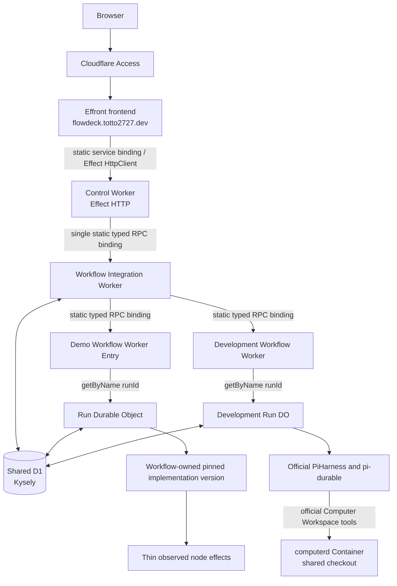
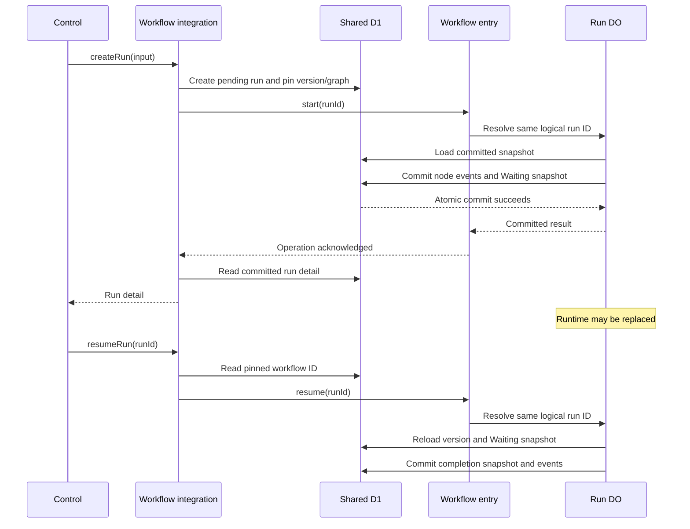

# Architecture

This document serves contributors and maintainers.
It implements the direction in the Flowdeck design dated 2026-10-17.
The current application is a local vertical-slice experiment, not a deployed service.

## Resource boundaries

All Workers, the D1 database, and the workspace Container belong to the `flowdeck` Alchemy project.
Each workflow has one Worker.
An additional integration Worker owns the catalog and fixed bindings to those workflow Workers.
The entry routes a run ID to one logical Durable Object ID.
The application does not depend on the lifetime of a JavaScript object instance.
Control and workflow Workers have no public domain, `workers.dev` endpoint, or preview endpoint.
The frontend is the only public entry point.
Development binds local ports 4380 through 4384 to loopback.

## Responsibilities

| Component               | Responsibility                                                                                   |
| ----------------------- | ------------------------------------------------------------------------------------------------ |
| Frontend                | Render shared shapes, inspect committed state and events, start and resume runs.                 |
| Control API             | Validate HTTP input, reject browser-originated mutations, and call one workflow service binding. |
| Workflow integration    | Expose the catalog and run operations, persist new runs, and select fixed workflow bindings.     |
| Workflow entry          | Resolve the run DO and forward typed operations.                                                 |
| Run DO                  | Load committed state and invoke the pinned workflow implementation.                              |
| Workflow implementation | Define version-specific nodes, transitions, checkpoint interpretation, and recovery.             |
| Shared DB               | Store workflow versions, immutable graphs, runs, snapshots, ordered events, and commit receipts. |

Do not add dynamic workflow registration, dynamic dispatch, a common runner protocol, binary transfer, or a shared artifact store.
Runtime resources and side-effect recovery belong to the workflow that uses them.

Worker entry points and Worker-specific features live under `src/workers/<worker>/`.
Shared workflow schemas, projections, and persistence live under `src/features/workflow/`.
The shared `Workflows` service is Control's only workflow dependency.
The application follows modular-monolith boundaries: each workflow is an independent application module behind a shared interface.
Workflow IDs, supported versions, input validation, initial snapshots, and graphs live under that workflow's own `features/input.ts` and `features/definition.ts`.
`src/features/workflow/services/workflow-definition.ts` defines only the neutral definition, executor, and registry contracts.
`src/workers/workflow/features/registration.ts` combines the workflow-provided definitions and fixed execution bindings into an array.
The integration service uses registry lookup for catalog, create, and resume operations without branching on workflow IDs.
The frontend renders version choices and input descriptors from the catalog without importing workflow implementations.
The shared create schema validates only the routing envelope and semantic version format; the selected definition validates all workflow-specific fields before persistence or dispatch.
New versions use strings parsed by Effect `SemVer`, not a shared version enumeration.
Legacy stored versions remain readable and are interpreted only by their owning workflow.
Adding a workflow requires its typed input schema, implementation, and integration registration, but no new Control binding.
An unknown persisted workflow ID is rejected rather than sent to the demo worker.
The final composition boundary in `src/workers/composition.ts` selects deployment and authorization Layers.
The frontend always invokes the injected authorization service before dispatch.
The Access implementation always verifies admission, audience, and identity, and never checks a development flag.
Local authorization is a separate injected implementation, not a fallback inside Access verification.
Feature logic does not inspect deployment stages, infrastructure phases, or development flags.

## Effect and interoperability

Application logic uses Effect services, Layers, schemas, collections, Match, and HTTP APIs.
External storage and service failures use `ExternalError` with required operation, cause, and kind fields.
Domain rejections such as `Conflict` and `InvalidSnapshot` have no optional cause field.
The HTTP boundary returns safe messages rather than external causes, retaining 500 for storage failures and 502 for service failures.
State-dependent fields belong to explicit tagged variants; optional properties are reserved for genuinely optional metadata.
Kysely query builders remain typed library values rather than an invented query abstraction.
The D1 adapter compiles Kysely queries into native D1 prepared statements.
D1 `batch` provides the atomic transaction that Kysely's interactive transaction callback cannot provide on D1.
The frontend adapts the native static binding to the Fetch implementation consumed by Effect HttpClient.
Native Request construction exists only in that adapter.
Alchemy owns native Worker HTTP and typed RPC bridges.
React and Playwright remain framework boundaries.

### State Machine API constraint

The design references the Effect 3 experimental Machine API.
The inspected Effect 4.0.1, 4.0.2, 4.0.5, and installed 4.0.6 do not export a compatible Machine module.
Do not describe this experiment as an official Machine integration.
The demo uses a small workflow-owned tagged state with a Schema restore boundary and Match transitions.
There is no replacement general-purpose state-machine engine.
Official Machine integration remains unresolved until an API compatible with the application Effect version is available.

The node wrapper records start, success, and failure through persistence hooks.
The workflow commits snapshots at its transition boundaries.
The demo states are Ready, Preparing, Waiting, Publishing, Completed, and Failed.
The two bundled implementations use different graph labels and task results.
The sample task bodies are pure, so a repeated interrupted task is safe.
This does not establish exactly-once external side effects.

## Data and graph identity

`src/features/identity/id.ts` separates caller-defined IDs from app-generated random IDs.
`UserDefinedId` accepts 1 to 128 ASCII letters, digits, underscores, or hyphens and rejects unsafe input instead of silently rewriting an identity.
`makePrefixedUUIDv4(prefix)` validates the configured prefix and returns `{ schema, make }`.
The schema uses official `Schema.TemplateLiteral` with `Schema.isUUID(4)` for the suffix.
The factory closes over that prefix and its decoder, created once, and returns `make` as an Effect value rather than a zero-argument function.
Use `yield* makeRunId` to generate an ID; each execution resolves the official Effect Crypto service from its current context.
The installed Effect 4.0.6 exposes UUID generation on `Crypto.Crypto`, not a module-level `Crypto.randomUUIDv4` accessor.
Tests can provide official `TestCrypto.layer(seed)` for reproducible UUID sequences without changing production code.
`PrefixedUUIDv4` and the concrete `RunId`, `ExecutionId`, `EventId`, `CommitId`, and `CommandId` types are inferred from their schemas and remain strings, without brands.
For example, `const { schema: RunId, make: makeRunId } = makePrefixedUUIDv4('run')` defines validation and generation together.
Shared workflow identities live in `src/features/workflow/domain/identity.ts`; the development feature owns its command identity.
The generic identity feature contains no ID-kind union, registry, or central generation dispatcher.
New app-owned IDs use `run_`, `execution_`, `event_`, `commit_`, or `command_` prefixes.
These prefixes describe origin, not authorization or creation time.

Persisted history decoders keep existing IDs readable, and development recovery retains raw UUIDv4 and the exact legacy run/node command identity rather than allocating a replacement.
New command input requires the prefixed schema.
Workflow-owned composite graph references and framework-owned Durable Object, Pi root-session, and provider-session IDs retain their native contracts.
Run ordering uses the existing `created_at` index, and event ordering uses the indexed run/sequence columns.
Neither ordering path depends on lexical ID order or UUIDv7.

| Record           | Key data                                                                      |
| ---------------- | ----------------------------------------------------------------------------- |
| Workflow         | Workflow ID and display name.                                                 |
| Workflow version | Workflow ID, implementation version, graph ID.                                |
| Graph            | Graph ID, schema version, graph JSON.                                         |
| Run              | Run ID, pinned version, immutable graph reference, status, revision.          |
| Run state        | Run ID, revision, snapshot.                                                   |
| Run event        | Event ID, run ID, ordered sequence, optional node/execution/attempt, payload. |
| Commit receipt   | Commit ID, exact command, revision, first event sequence, event count.        |

The current graph IDs are explicit versioned identifiers, not content hashes.
A repeated identical graph is reused.
Database guards reject reuse of a graph ID with different content and prevent graph or version updates.
Change the graph ID and workflow version when a graph contract changes.
A node ID identifies a definition.
An execution ID and attempt identify an execution, including retries.
Graph-to-shape conversion and event projection use these identities independently from transient UI selection.

## Commit and acknowledgment

1. Construct a typed transition command with an expected revision and a stable commit ID.
2. Compile the receipt, run update, snapshot update, and event inserts with Kysely.
3. Submit the statements in one D1 batch.
4. Reject a stale revision or a changed command that reuses a commit ID.
5. Return an acknowledgment only after the batch succeeds and the receipt is read.

The revision guard executes inside the database transaction.
Duplicate event IDs within a command are rejected before the batch starts.
An event-ID collision in another commit aborts the complete batch.
An identical command can receive its previous receipt even after later revisions.
State and events therefore have one commit boundary.
Run detail reads use a revision-bounded event prefix so a newer transition cannot attach newer events to an older snapshot.
The shared DB is canonical for integration Worker and DO reads.
Applied SQL migrations are immutable.
Add a new forward migration to strengthen database guards without rewriting local or deployed history.

## Start and recovery

Control forwards creation to the integration Worker.
The integration Worker persists a new pending run, its version, and its graph before calling the selected workflow binding.
A binding failure must leave the pending run available for explicit recovery.
A DO call loads the last committed state instead of using a cached continuation.
Start runs the first node and waits at the manual checkpoint.
Resume completes the checkpoint and runs the second node.
Preparing and Publishing snapshots identify interrupted node executions and permit the demo's safe task retry.
Completed and Failed are terminal and cannot run again.

DO replacement does not itself trigger execution.
The current recovery trigger is an explicit RPC through the resume operation.
Alarms, reconnecting runners, and environment-specific checkpoints are workflow extensions, not implied common guarantees.

## Frontend styling

Application components use Tailwind utilities and the local shadcn/ui components.
`src/workers/frontend/features/styles/app.css` contains only Tailwind imports, shadcn theme mappings, and base configuration, not application selectors.
Graph canvas dimensions and node coordinates come from persisted graph projections at runtime.
These unbounded numeric values cannot be enumerated as statically discovered Tailwind classes, so the graph uses a documented inline geometry boundary while Tailwind controls its appearance, state, and interaction styling.
Each unavoidable nonstandard implementation must document its purpose, rejected standard alternatives, and exact scope beside the code before review.

## Version lifecycle

New runs explicitly select a semantic version advertised by their workflow definition.
The demo advertises `1.0.0` and `2.0.0`; the development workflow advertises `1.0.0`.
Only each workflow's restore boundary interprets its retained legacy `v1` or `v2` identities.
Existing runs restore their stored version rather than a mutable latest alias.
Keep old code while a pending, active, waiting, or recoverable run references it.
Remove an old implementation only after its resumable runs have reached a terminal state.
The retained graph, state, and events do not guarantee execution after code removal.
Dependency upgrades do not preserve an old runtime binary or complete historical reproducibility.
No code-removal automation exists in this experiment.

## Access and domain

The production hostname is `flowdeck.totto2727.dev`.
Production declares a self-hosted Cloudflare Access application and an exact-email allow policy in the same stack.
`FLOWDECK_ACCESS_EMAILS` must be nonempty and must not contain wildcard or domain-wide grants.
The runtime checks the trusted native Access execution context, its audience, and the admitted identity before handling any Effront request, including ServerFns.
Caller-supplied identity headers grant no access.
The private Control mutation routes reject browser Origin headers before parsing the body.
Browser mutations use authenticated Effront ServerFns, which call Control through the server-side binding.
A missing Access context returns 401, a wrong audience or identity returns 403, and an unavailable identity service or invalid configuration returns 503.
Only the local composition boundary can inject the development bypass.
There is no public API token or browser-controlled bypass.
Control trusts the Worker that holds its service binding, rather than authenticating an end user again.
Every admitted frontend identity currently has access to the same runs.
There is no per-user ownership or per-run authorization model.
Private ingress restricts callers but does not replace user-level authorization if the application later adds separate user or tenant permissions.

Cloudflare resources are not deployed by local development.
Cloudflare credentials and account selection remain standard Alchemy inputs.
Do not add a deployment task or enable a cloud operation without operator authorization.
Production DNS, Access admission, and deployment behavior require a separate authorized cloud acceptance test.

## Remaining work

- Integrate an official Effect Machine API if a compatible version becomes available.
- Resolve the remaining PiHarness task acceptance and environment limits before deployment; see [development sandbox](development-sandbox.md).
- Add Cloudflare Workflows nodes as another workflow-owned integration.
- Establish production operating limits, retention, pagination, and old-version removal procedures before a larger deployment.
- Authorize and validate the real production domain and Access policy before release.

## Source references

- [Effect Machine v3](https://effect.website/docs/v3/api/experimental/Machine)
- [Cloudflare service bindings](https://developers.cloudflare.com/workers/runtime-apis/bindings/service-bindings/)
- [Durable Object lifecycle](https://developers.cloudflare.com/durable-objects/concepts/durable-object-lifecycle/)
- [D1 atomic batch API](https://developers.cloudflare.com/d1/worker-api/d1-database/#batch)
- [Cloudflare Access for Workers](https://developers.cloudflare.com/cloudflare-one/access-controls/applications/non-http/cloudflare-workers/)
- [Kysely D1 dialect](https://github.com/aidenwallis/kysely-d1)
- [Vite+ migration and toolchain overrides](https://viteplus.dev/guide/migrate)

The toolchain starts from `template/vite-plus-app` revision `f0b8dffb085518d10cd42729a10c11de08a1736b`.
The Effront, shadcn, and multi-Worker composition references come from Projektor revision `a8dae3d5c54b1eb67e2d7f4dd095584b309ced3a`.
