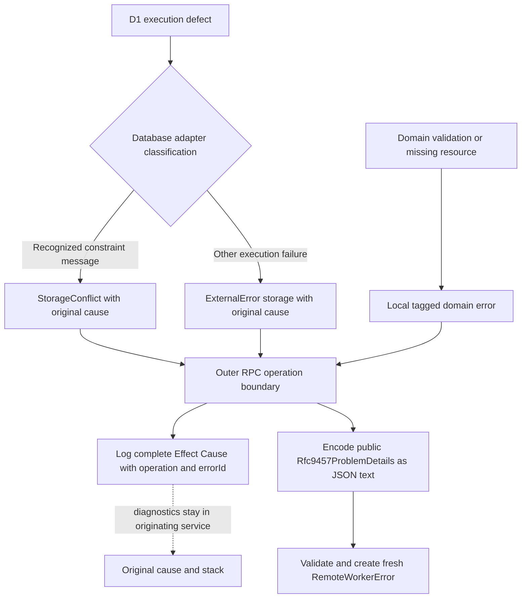
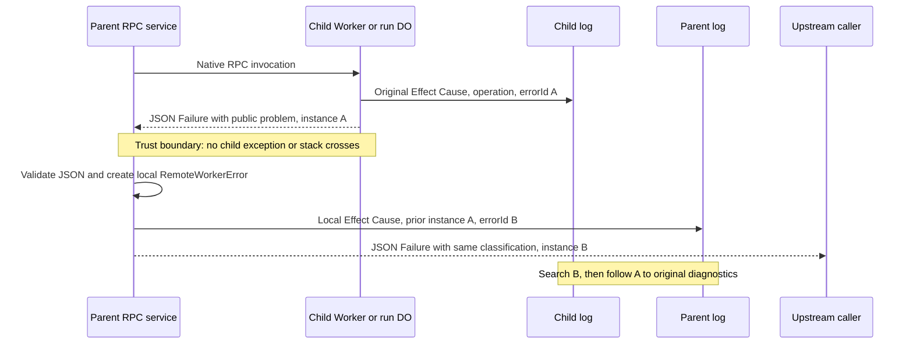

# RPC boundaries

## Contract

Keep original diagnostics in the service that failed, send only a validated public problem across RPC, and create a new local error at each receiver.
An operator follows problem occurrence IDs through service logs to find the original cause and stack.
A caller never receives a reconstructed child exception.

Worker and Durable Object RPC calls are external API boundaries.
Each application-owned workflow RPC method returns JSON text, not a domain object, an `Error` instance, or a rejected domain failure.
The shared codec is `Schema.fromJsonString(Schema.toCodecJson(Schema.Result(Schema.Json, Rfc9457ProblemDetails)))`.
It uses the official Effect Result codec, not an application-defined tagged union.
The canonical wire shapes are `{ "_tag": "Success", "success": <JSON value> }` and `{ "_tag": "Failure", "failure": <Problem Details object> }`.
Commands return JSON `null` as their successful value.
Domain values use their JSON codecs before entering the response boundary.
Each receiver decodes the envelope and its operation-specific value before using the result.
The declared `never` error channel describes application replies, not a guarantee that native transport, defects, or cancellation cannot fail.

Keep three representations distinct: an `Effect` is the executable operation, a local `Result` is its explicit success or public failure value, and the wire reply is JSON text encoded from that value.
The responder constructs local values with `Result.succeed` or `Result.fail` before encoding them.
The receiver decodes back to a local `Result`, branches with `Result.isSuccess`, and reads `success` or `failure`.
It then returns an Effect success or fails the caller's Effect with a fresh local `RemoteWorkerError`.
`Rfc9457ProblemDetails` is the application's constrained RFC 9457 profile, not an unrestricted implementation of every possible RFC problem.
Its source comment links directly to RFC 9457 section 3 and explains the fixed public fields and UUIDv4 occurrences.

The error representation uses the JSON model from [RFC 9457](https://www.rfc-editor.org/rfc/rfc9457.html#section-3), embedded in the RPC failure envelope as described in [Appendix D](https://www.rfc-editor.org/rfc/rfc9457.html#appendix-D).
This does not make native Worker RPC an HTTP transport.
The `status` field describes the corresponding HTTP failure, not a native RPC transport status.
Problem type identifiers are the absolute URLs of the definitions below.

## Error representations

These representations serve different purposes and must not be merged into an optional-cause error shape.

| Representation            | Purpose                                                                                   | Required diagnostic data                                                                                      | Boundary rule                                                                                                       |
| ------------------------- | ----------------------------------------------------------------------------------------- | ------------------------------------------------------------------------------------------------------------- | ------------------------------------------------------------------------------------------------------------------- |
| Domain `Data.TaggedError` | Identify an expected local failure through `_tag` and typed fields                        | `Conflict`, `InvalidOperation`, and `InvalidSnapshot` require a message, while `NotFound` requires a resource | Do not serialize the error instance or its message as an RPC problem                                                |
| `StorageConflict`         | Identify a database conflict with diagnostic provenance                                   | `message`, `operation`, and original `cause: unknown`                                                         | Keep the original cause in the originating service log                                                              |
| `ExternalError`           | Identify a storage or service dependency failure                                          | `operation`, `kind`, and `cause: unknown`                                                                     | Preserve local dependency diagnostics, but sanitize untrusted native RPC diagnostics before constructing this error |
| `Effect.Cause<E>`         | Describe the complete Effect failure, including typed failures, defects, and interruption | The runtime cause, not just the error selected for classification                                             | Log the complete cause at the outer operation boundary                                                              |
| `Rfc9457ProblemDetails`   | Represent a public problem occurrence as JSON                                             | A validated fixed `type`, `title`, `status`, and `detail`, plus UUIDv4 `instance`                             | No original message, stack, or nested diagnostic cause                                                              |
| `RemoteWorkerError`       | Identify a validated application failure from another service                             | Local `operation` and required `cause: Rfc9457ProblemDetails`                                                 | Construct a fresh local error, never revive the child error                                                         |
| Frontend `ControlError`   | Give the dashboard a safe retry message                                                   | A fixed local `message`                                                                                       | Do not retain or expose Control response diagnostics                                                                |

`Data.TaggedError` defines a local error class and typed discriminant.
It is not a transport codec and does not make its fields safe to disclose.
An original `cause: unknown` accepts the actual value thrown by a dependency without assuming it is an `Error`.
That field is not the same as the enclosing `Effect.Cause`, which records how the computation failed.
`RemoteWorkerError.cause` is deliberately narrower: it must be a validated `Rfc9457ProblemDetails`, not an arbitrary original exception.

A domain conflict has no external cause to preserve.
A storage conflict must retain its original cause and operation.
Keep `Conflict` and `StorageConflict` separate rather than adding an optional `cause` to one shared constructor.
The constructor assertions in [the error contract tests](../src/features/workflow/domain/errors.test.ts) enforce this distinction.

## Failure flow

### Database and domain origin

[DatabaseQueries.execute](../src/features/workflow/services/database-queries.ts) catches defects from the selected D1 executor and converts them into checked storage failures.
The current classifier uses an `Error` message containing `flowdeck_` or `UNIQUE constraint` to construct `StorageConflict`.
Other database execution defects become `ExternalError` with `kind: 'storage'`.
Both cases retain the original value as the required `cause` and attach the operation name.
This message-based classification is specific to the current database adapter, not a general domain-error revival mechanism.

[D1Store](../src/features/workflow/services/d1-store.ts) also creates domain failures directly, such as `NotFound` for a missing row and `Conflict` for an invalid new-run state or duplicate event IDs within a commit.
The adapter does not emit a second failure log.
The enclosing RPC or HTTP operation owns logging and response translation.

### Child Worker or Durable Object response

1. The entrypoint validates its request and runs the operation inside the responder returned by `makeRpcResponse`.
2. The responder encodes a successful JSON value, or catches the complete Effect cause on failure.
3. Cancellation-only interruption remains cancellation and produces neither a failure log nor an application reply.
4. For other causes, the responder generates a UUIDv4 `errorId` as an absolute `urn:uuid:` URI.
5. It selects a typed error for public classification with `Cause.findErrorOption`, while retaining the complete cause for logging.
6. It records `RPC operation failed` with the original cause and the `operation` and `errorId` log annotations.
7. It returns JSON text containing the failure envelope and the validated problem whose `instance` equals that `errorId`.

A pure defect has no typed error to classify and becomes an `internal` problem.
Server-produced value encoding failures are deliberately converted to defects with `Effect.orDie`, so they become `internal`, not `invalid-request`.
A checked inbound `SchemaError` becomes `invalid-request`.
A cause that contains both interruption and a real failure is not cancellation-only and is still logged.

The response contains no original stack, nested diagnostic cause, private exception message, request body, or error-class instance.
The complete cause in the origin log retains diagnostic stacks and nested original causes.
This separation also avoids serializing cyclic original causes.

### Parent validation and multi-hop correlation

The parent applies `rpcCall` only to the native Alchemy RPC invocation, before application decoding.
The SDK can fail or decode its own error envelope before the application JSON protocol runs.
Such failures and defects can contain arbitrary peer diagnostics.
`rpcCall` discards them and creates a local `ExternalError` with a fixed service-call failure cause.
Cancellation-only interruption is preserved.
This transport path cannot promise the correlation ID that an application failure envelope would provide.

After a successful native call, `rpcResult` validates the JSON-text envelope and the complete public problem contract.
Unknown envelope properties are rejected.
Unknown problem extensions are discarded, so a peer cannot attach a stack or nested cause to the retained problem.
The problem type, title, status, and detail must match one of the fixed public classifications, and `instance` must contain a UUIDv4.
Malformed replies become a local service `ExternalError` with a fixed cause, without retaining decoder diagnostics or peer bytes.
`rpcValue` then validates the operation-specific success value, and `rpcCommandResult` requires `null` for an acknowledgement.

A valid failure envelope becomes a new `RemoteWorkerError` with the caller's operation name and the validated problem as its required cause.
Its stack belongs to the caller.
There is no remote error-class revival and no recovery decision based on a restored child exception.

If that parent is also an RPC service, its responder logs the local error with a new error ID.
It preserves the validated public classification and replaces `instance` with the new occurrence ID.
Its log contains the preceding occurrence in `RemoteWorkerError.cause.instance`.
Follow that preceding ID to the child log, repeating until the original diagnostic stack is reached.
Only the immediate service's occurrence ID is returned at each hop, not the entire diagnostic chain.

The implemented command route is Control → Workflow integration Worker → selected workflow Worker → run Durable Object.
The selected Worker is DemoWorkflow or DevelopmentWorkflow, and each forwarding RPC boundary creates its own occurrence on failure.
Catalog and read operations can fail in the integration Worker without calling a run Durable Object.
The responder captures Crypto at service initialization through `makeRpcResponse`.
`rpcResponse` is a convenience adapter used where that responder has not already been captured, including boundary test fixtures.

Native Alchemy Worker RPC and native Cloudflare entrypoints do not expose the Effect RPC server middleware hook.
The shared codec adapter is confined to those entrypoints.
HTTP interception and failure translation remain registered `HttpRouter.middleware` implementations.

## Control HTTP and frontend translation

[Control's RPC client](../src/workers/control/control.ts) uses `rpcCall` before `rpcValue` for its single Workflow service binding.
`makeControl` builds the router and HTTP handler once in the Worker initialization scope, then reuses the handler in `fetch`.
The lazy Alchemy RPC stub still resolves `WORKFLOW` from the current request's `WorkerEnvironment`, so handler reuse does not retain a previous request's binding.
[The Control router](../src/workers/control/features/router.ts) installs `ApiErrors` as registered middleware.
It applies `operationFailureLogging` before translating typed failures, so the local cause is available to the log rather than being replaced by an HTTP response first.
The logger skips cancellation-only interruption and disables duplicate standard response logging for the failure.
It observes defects without converting them into typed failures.

For `RemoteWorkerError`, `ApiErrors` uses the validated problem status and public detail.
It maps the five request/domain problem types to `NotFound`, `Conflict`, `InvalidOperation`, `InvalidSnapshot`, or `InvalidRequest` API error names.
Storage, service, and internal problems use the API error name `ExternalError`.
The HTTP body is the application's `{ error, message }` schema, not the RPC failure envelope or an RFC 9457 HTTP body.
The middleware does not add a fresh RPC `errorId` or include the problem `instance` in that HTTP body.
The HTTP log still contains the validated remote problem occurrence in its local error cause.

Direct local typed failures have separate mappings in `ApiErrors`.
In particular, local `InvalidOperation` uses its domain message, while a remote invalid operation uses the fixed validated problem detail.
Unexpected defects are logged, but the typed translation table does not convert them into the RPC problem schema.
Do not infer that every HTTP failure follows the RPC classification path.

[Frontend ControlApi](../src/workers/frontend/features/control-api.ts) uses Effect HttpClient, requires a successful HTTP status, and decodes the success body with the operation's domain codec.
Transport, status, and success-body decoding failures become a new message-only `ControlError` with fixed retry guidance.
Starting a run has a separate fixed failure message.
It does not decode the Control error body or preserve its occurrence ID, and it does not add a failure log.
[ServerFns](../src/workers/frontend/features/server.ts) convert `ControlError` into an `{ ok: false, message }` result.
[The initial page](../src/workers/frontend/features/entry.effront.tsx) renders retry guidance for the same error.
The original diagnostic trail therefore ends in service logs, not in the dashboard message.

## Responsibilities and evidence

Source links describe the implementation, and test links identify maintained regression coverage.
The test coverage listed here does not by itself establish deployment or live PiHarness acceptance.

| Responsibility                                                                                  | Implementation                                                                                                                                                                                    | Maintained evidence                                                                                                                                                   |
| ----------------------------------------------------------------------------------------------- | ------------------------------------------------------------------------------------------------------------------------------------------------------------------------------------------------- | --------------------------------------------------------------------------------------------------------------------------------------------------------------------- |
| Separate domain conflicts from storage failures with required original causes                   | [Domain errors](../src/features/workflow/domain/errors.ts)                                                                                                                                        | [Constructor type and runtime assertions](../src/features/workflow/domain/errors.test.ts)                                                                             |
| Convert D1 execution defects without adapter-level duplicate logs                               | [DatabaseQueries](../src/features/workflow/services/database-queries.ts), [D1Store](../src/features/workflow/services/d1-store.ts)                                                                | [Real-D1 constraints](../tests/database.test.ts), [origin stack logging](../src/features/operation-logging.test.ts)                                                   |
| Encode JSON-only replies, classify failures, and log complete causes with unique occurrence IDs | [RPC boundary](../src/features/rpc-boundary.ts), [problem schema](../src/features/rpc-problem.ts)                                                                                                 | [Codec, sanitization, defects, interruption, and multi-hop tests](../src/features/rpc-boundary.test.ts)                                                               |
| Discard unsafe native SDK diagnostics before parent logging and validate operation values       | [Workflow RPC client adapters](../src/features/workflow/services/workflow-rpc.ts)                                                                                                                 | [Native SDK stub and operation value tests](../src/features/workflow/services/workflow-rpc.test.ts)                                                                   |
| Apply the responder and decoder at actual Worker and DO entrypoints                             | [Integration Worker](../src/workers/workflow.ts), [Demo Worker and DO](../src/workers/demo-workflow/demo-workflow.ts), [Development Worker and DO](../src/workers/development-workflow/worker.ts) | [Native Worker service-binding fixture tests](../tests/rpc-boundary.test.ts)                                                                                          |
| Log once before HTTP translation and preserve remote public classification                      | [HTTP operation logger](../src/features/operation-logging.ts), [Control router](../src/workers/control/features/router.ts)                                                                        | [Real router logging and conflict translation tests](../src/features/operation-logging.test.ts), [router codec tests](../src/workers/control/features/router.test.ts) |
| Reuse the Control HTTP handler without retaining a previous request's service binding           | [Control initialization](../src/workers/control/control.ts)                                                                                                                                       | [Construction without bindings and concurrent binding isolation](../src/workers/control/control.test.ts)                                                              |
| Give the frontend validated domain values or fixed retry feedback                               | [ControlApi](../src/workers/frontend/features/control-api.ts), [ServerFns](../src/workers/frontend/features/server.ts)                                                                            | [HTTP client response and failure tests](../src/workers/frontend/features/control-api.test.ts)                                                                        |

## Problem types

Each heading defines a type URI by appending its fragment to this document's canonical URL.
The detail is a fixed, public description, not the original exception message.
Keep these headings stable because the runtime codec uses their canonical fragments.
The exact wire values below are defined by `Rfc9457ProblemDetails`, and `classify` selects them from local typed failures.

### Not found

Status: 404.
Title: `not-found`.
Detail: `The requested resource was not found.`
Selected for `NotFound`.

### Conflict

Status: 409.
Title: `conflict`.
Detail: `The operation conflicts with the current state.`
Selected for both `Conflict` and `StorageConflict`.

### Invalid operation

Status: 409.
Title: `invalid-operation`.
Detail: `The operation is not allowed in the current state.`
Selected for `InvalidOperation`.

### Invalid snapshot

Status: 409.
Title: `invalid-snapshot`.
Detail: `The workflow state cannot be used for this operation.`
Selected for `InvalidSnapshot`.

### Storage

Status: 500.
Title: `storage`.
Detail: `A persistence operation failed.`
Selected for `ExternalError` with `kind: 'storage'`.

### Service

Status: 502.
Title: `service`.
Detail: `A required service could not complete the operation.`
Selected for `ExternalError` with `kind: 'service'`.
A service problem does not itself guarantee that a run was persisted or that recovery will succeed.
Inspect the committed workflow checkpoint and use the workflow's explicit recovery contract.

### Invalid request

Status: 400.
Title: `invalid-request`.
Detail: `The request did not match the expected schema.`
Selected for a checked `SchemaError` at the RPC response boundary.

### Internal

Status: 500.
Title: `internal`.
Detail: `The operation could not be completed.`
Selected when no typed classification matches, including pure defects and outbound encoding defects.
The error ID identifies the service log that contains diagnostic information.
