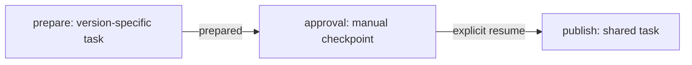
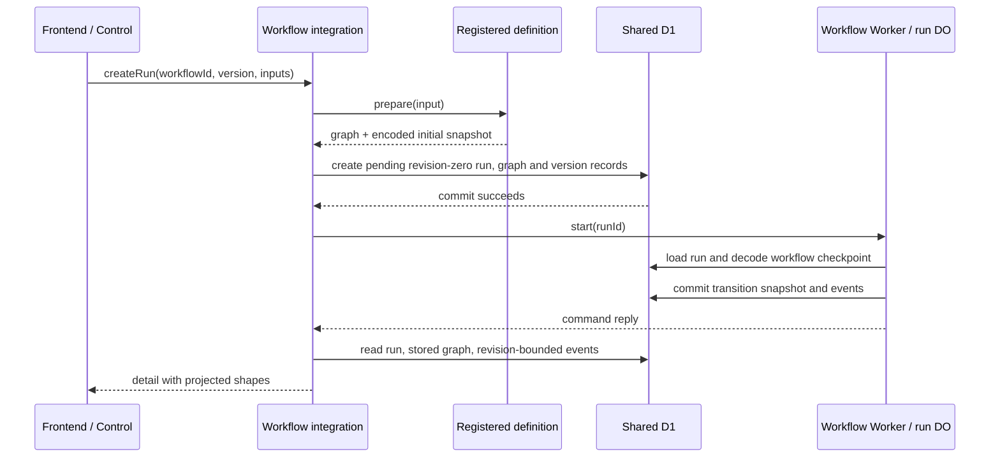

# Workflow graphs

This document explains the current graph construction and execution model for contributors who add or change a workflow.
It describes the implementation, not a proposed graph interpreter.
See [architecture](architecture.md), [database workflow](database.md), and [RPC boundaries](rpc-boundaries.md) for the surrounding resource, persistence, and transport contracts.

## Overview

**Flowdeck stores a versioned visual graph, but workflow-owned Effect programs execute the work.**
`GraphDefinition` describes nodes and edges for persistence and presentation.
It does not contain task effects, transition handlers, conditions, timers, or approval rules.
The demo and Pi development workflows each decode a typed checkpoint and explicitly select the next operation with `Match`.
Adding an edge does not make that operation execute.

There are three different structures to keep separate:

| Structure                          | Owner                                       | Purpose                                                                                  |
| ---------------------------------- | ------------------------------------------- | ---------------------------------------------------------------------------------------- |
| `GraphDefinition`                  | Each workflow implementation                | Name the visible nodes and edges, and retain the graph associated with a run.            |
| Typed snapshot and transition code | Each workflow executor                      | Decide what work to perform, what to persist, when to wait, and how to recover.          |
| `Shapes`                           | Shared projection, rendered by the frontend | Combine the persisted graph with committed events to show node state and edge traversal. |

The public contracts are in [workflow-definition.ts](../src/features/workflow/services/workflow-definition.ts) and [model.ts](../src/features/workflow/domain/model.ts).
The shared interfaces do not prescribe a workflow's checkpoint schema or execution engine.

## Is Effect StateMachine adopted?

**No official Effect Machine or StateMachine runtime is adopted by the current workflow implementation.**
The earlier design reference is the [Effect 3 experimental Machine API](https://effect.website/docs/v3/api/experimental/Machine), as recorded in the [architecture API constraint](architecture.md#state-machine-api-constraint).
The installed `effect` package inspected for this document is `4.0.6`, and [package.json](../package.json) declares `^4.0.6`.
Inspection of the installed package's exports and source files found no Machine or StateMachine module.
The wildcard subpath export is not evidence that such a module exists.
A source search found no application import or use of either API.

The actual demo restore and drive code is in [demo.ts](../src/workers/demo-workflow/features/demo.ts).
It uses `Schema.TaggedStruct`, a tagged union, `Schema.toCodecJson`, and `Match` transitions.
The development workflow uses the same Effect primitives with its own distinct snapshot and operations in [development.ts](../src/workers/development-workflow/features/development.ts).
These are workflow-specific checkpoint implementations, not a shared replacement state-machine framework.
Official Machine integration is still identified as unresolved in the repository policy and architecture documentation.
This status does not establish why any historical proposal changed, or make a claim about every Effect release.

## Graph contract and ownership

The current [graph schema](../src/features/workflow/domain/model.ts) has these fields:

| Contract          | Fields                                                  |
| ----------------- | ------------------------------------------------------- |
| `GraphDefinition` | `graphId`, literal `schemaVersion: 1`, `nodes`, `edges` |
| `GraphNode`       | `nodeId`, `label`, `kind: 'task' \| 'checkpoint'`       |
| `GraphEdge`       | `edgeId`, `source`, `target`, `label`                   |

Workflow, graph, node, and edge IDs are caller-defined identifiers validated by [the identity schemas](../src/features/workflow/domain/identity.ts).
They are distinct from generated run, execution, event, and commit IDs.
A node ID names a definition, while a node event also carries its execution ID and positive attempt number.
A graph node's `checkpoint` kind is presentation metadata, not an instruction to suspend execution.

The schema checks field shapes and identifier formats.
It does not encode endpoint membership, unique node or edge IDs, acyclicity, reachability, branch conditions, or an execution order.
Authors must keep the graph and executable transitions consistent and test that consistency.
The current examples are linear, but their linear execution comes from workflow code rather than edge traversal.

### Demo versions are separate definitions

[version-1.ts](../src/workers/demo-workflow/features/version-1.ts) and [version-2.ts](../src/workers/demo-workflow/features/version-2.ts) each define their own version, graph, and prepare effect.
Version `1.0.0` uses graph ID `demo-1_0_0-graph-1` and produces `draft:v1`.
Version `2.0.0` uses graph ID `demo-2_0_0-graph-1` and produces `draft:v2:reviewed`.
They share node IDs and topology but have different task labels and outputs.
`demoImplementation(version)` selects one definition at the version boundary.
The common prepare, approval, and publish transition mechanics are shared because those mechanics are identical for these two versions.

This diagram describes the graph and the matching implemented path.
The labels `prepared` and `resume` are not event dispatch keys interpreted by a graph engine.

### Pi development owns a different graph and executor

[development.ts](../src/workers/development-workflow/features/development.ts) owns graph `jcode-development-1_0_0-graph-1` for version `1.0.0`.
Its visible path is `implement` → `verify`, with edge label `implementation complete`.
Both nodes have kind `task`.
Its waiting state means a submitted Pi turn awaits explicit resume and receipt inspection, not a manual approval node.
`developmentGraphFor` currently returns the sole supported graph.
The workflow-specific [input schema](../src/workers/development-workflow/features/input.ts) restricts supported versions before preparation, and restore validates the stored version as well.

## Registration, creation, and version persistence

Each workflow supplies a `WorkflowDefinition` with a catalog `summary` and `prepare(input)`.
Preparation validates workflow-specific input and returns `{ graph, snapshot }`, where the snapshot is an encoded JSON object.
The demo's [definition](../src/workers/demo-workflow/features/definition.ts) and the development [definition](../src/workers/development-workflow/features/definition.ts) implement that neutral contract independently.
A `WorkflowExecutor` exposes only `start(runId)` and `resume(runId)`.

[registration.ts](../src/workers/workflow/features/registration.ts) is the composition feature that combines installed definitions with static execution bindings.
The [integration service](../src/workers/workflow/features/workflow.ts) performs registry lookup without workflow-specific execution branches.
Control keeps its single integration Worker binding.
Each workflow Worker routes the run ID to its own run Durable Object, rather than creating a Durable Object for every node.
See the [demo entry](../src/workers/demo-workflow/demo-workflow.ts), [development Worker](../src/workers/development-workflow/worker.ts), and [static bindings](../src/workers/workflow/features/workflow-binding.ts).

Preparation finishes before run ID generation or persistence.
Creation stores the requested implementation version, graph ID, initial snapshot, and status before calling the execution binding.
A failed start call therefore leaves a pending run available for explicit recovery.

[D1Store](../src/features/workflow/services/d1-store.ts) stores graph JSON and the workflow-version-to-graph association alongside the run and snapshot in one creation batch.
[Schema constraints](../schema/schema.hcl), [identity and immutability triggers](../schema/triggers.hcl), and the [generated migration](../migrations/) enforce the persisted identity and immutability rules.
Graph IDs are explicit identifiers, not content hashes.
Identical graph reuse is allowed, but reusing an existing graph ID with different content is rejected.
A graph contract change requires a new graph ID and workflow version rather than editing a published record in place.

Persisting a version is not archiving executable code.
The deployed workflow must still contain the pinned implementation and a compatible restore schema to recover that run.
Neither resume nor detail lookup silently upgrades a run to the latest catalog version.

## Waiting, approval, resume, and cold restoration

### Demo checkpoint execution

The demo checkpoint union is `Ready`, `Preparing`, `Waiting`, `Publishing`, `Completed`, or `Failed`.
`makeDrive` reads the canonical run from D1 on every call and validates its snapshot with `restoreDemo`.
Restore requires agreement between workflow identity, snapshot version, run version, graph ID, and status.

| Stored checkpoint       | `start` behavior                     | `resume` behavior                     |
| ----------------------- | ------------------------------------ | ------------------------------------- |
| `Ready` or `Preparing`  | Execute or recover prepare.          | Execute or recover prepare.           |
| `Waiting`               | Leave the manual checkpoint waiting. | Commit approval and begin publishing. |
| `Publishing`            | Recover publish.                     | Recover publish.                      |
| `Completed` or `Failed` | Reject execution.                    | Reject execution.                     |

Prepare commits its running checkpoint and `node.started` before the task body runs.
On success, it commits the prepared value, an approval execution ID, prepare success, approval start, and `run.waiting` together.
The task does not remain suspended in an in-memory fiber at this point.

Resume from `Waiting` commits `run.resumed`, approval success with `{ approved: true }`, and publish start with the `Publishing` checkpoint.
Publishing then commits its result and terminal events.
The current resume contract accepts only a run ID.
The demo has no separate approval decision payload, rejection path, approver record, or graph-declared approval policy.
Its manual approval is exactly the executor's interpretation of an explicit resume operation, within the application's existing authorization boundary.

[observeNode](../src/workers/demo-workflow/features/node.ts) is a lifecycle wrapper with workflow-owned persistence hooks, not a scheduler.
Recovering `Preparing` or `Publishing` reuses committed execution identity and skips the already committed start hook.
The demo bodies are pure, so retrying them is safe.
This is not evidence of exactly-once external side effects or a generic retry policy.

### Pi development checkpoint execution

The development checkpoint union is `Ready`, `Starting`, `PendingTurn`, `AwaitingTurn`, `Completing`, `Completed`, or `Failed`.
The executor commits command and execution identity before submitting work.
`PendingTurn` looks up the exact command before submission, and only authoritative absence permits submitting that same command again.
`AwaitingTurn` is persisted as run status `waiting` and emits `run.waiting` for the current task node.

Repeated `start` calls leave `AwaitingTurn` alone.
Explicit `resume` polls the stored command's receipt.
A still-running receipt does not advance the checkpoint or add events.
A completed implementation receipt explicitly commits the transition to `verify` and submits a verification turn in the same session.
A completed verification receipt proceeds through `Completing` before the final run checkpoint.
An acknowledged turn whose receipt disappears fails instead of being automatically resubmitted.

The official PiHarness owns durable conversation and operation state in Durable Object storage.
D1 owns the workflow checkpoint and events, so reconstructing a workflow executor does not require an in-memory continuation, but recovery also depends on the original Pi session and workspace being available.
The workflow checks those identities and fails closed in the implemented missing-session cases.
See [sandbox setup and acceptance limits](development-sandbox.md) and [workspace retention](development-workflow-retention.md) for the external-runtime boundary and its remaining limitations.
Retention jobs do not advance workflow nodes or substitute for explicit resume.

### Atomicity is at a checkpoint boundary

Both executors use `Store.commit` with the expected revision, encoded snapshot, run status, and event batch.
The store prepares statements and atomically writes the receipt, run update, snapshot, and ordered events before returning an acknowledgment.
An exact duplicate commit returns its original acknowledgment, while changed duplicate commands and conflicting revisions are rejected.
This protects committed workflow state, not arbitrary external effects between checkpoints.
Recovery behavior remains the responsibility of each workflow.

## What the graph drives in the UI

The integration service reads the run's stored graph and events through the run revision, then invokes [graphToShapes](../src/features/workflow/domain/projection.ts).
It does not regenerate an old run's graph from the current catalog.
Projection sorts events by durable sequence, not wall-clock timestamp or delivery order.
The latest applicable node event determines `running`, `succeeded`, `failed`, or `waiting`, with `idle` as the default.
Node positions follow graph array order in a single horizontal row with fixed geometry.
This is not a dependency-aware or automatic DAG layout.

An edge is marked traversed when any source success and any target start exist in the event set.
There is no persisted edge-traversal event, temporal pairing, execution-pair matching, or branch-condition evaluation in that calculation.
The indicator is a historical visual inference and can remain traversed while a later source attempt is active.
It must not be used as execution authorization or proof of a particular transition.

The frontend [RunGraph and NodeInspector](../src/workers/frontend/features/graph.tsx) render the shapes and inspect committed node events, execution identity, attempt, and latest payload.
[Presentation helpers](../src/workers/frontend/features/presentation.ts) keep node selection separate from projected execution state and navigate by definition order with arrow keys, Home, and End.
Pointer selection and keyboard selection do not alter a run or execute a node.
The [dashboard](../src/workers/frontend/features/dashboard.tsx) offers resume for waiting runs and recovery for pending or running runs through the same resume endpoint.
Refreshing detail only reads committed state, while resume invokes the executor.

## Authoring checklist

1. Define the workflow's ID, supported `SemVer` values, input schema, and catalog descriptors in its own feature module.
2. Define a graph with stable node IDs, explicit edge IDs and endpoints, and a new graph ID for a changed versioned contract.
3. Define the full typed snapshot union and JSON codec, including all identity required to reconnect or retry after runtime replacement.
4. Implement preparation to validate input and return the matching graph and encoded initial snapshot.
5. Implement `start` and `resume` to load committed state, validate version and graph agreement, and explicitly dispatch workflow-owned operations.
6. For every new node, add both the visible node and the executable transition, including checkpoint writes and node lifecycle events with consistent IDs.
7. For a manual approval or other wait, persist the wait state and `run.waiting`, return from the operation, and explicitly define what resume means.
8. Add the workflow Worker, run Durable Object, complete runtime Layers, and static execution binding at application composition, then register the definition and binding in the integration registry.
9. Test version selection, graph stability, wait and resume behavior, commit ordering, failure behavior, and cold restoration with the chosen external-side-effect recovery policy.

An edge-only edit does not implement a transition.
A node-only edit does not implement a task.
A `checkpoint` label does not implement approval.
There is no graph-provided timer or automatic wake-up contract.
New timed waits, branches, or approval decisions need explicit workflow behavior and corresponding tests rather than assumed graph semantics.

## Evidence and regression tests

These maintained tests identify the contracts described above.
This document is based on source inspection, not a new claim of deployment or live Pi acceptance.

| Evidence                                                                                                                                                                       | Behavior covered                                                                                                                                                |
| ------------------------------------------------------------------------------------------------------------------------------------------------------------------------------ | --------------------------------------------------------------------------------------------------------------------------------------------------------------- |
| [Demo definition tests](../src/workers/demo-workflow/features/definition.test.ts) and [snapshots](../src/workers/demo-workflow/features/__snapshots__/definition.test.ts.snap) | Both versioned graphs, initial snapshots, restore agreement, strict inputs, and execution identity.                                                             |
| [Node wrapper tests](../src/workers/demo-workflow/features/node.test.ts)                                                                                                       | Observable lifecycle hooks for success and failure.                                                                                                             |
| [D1 store and recovery tests](../src/features/workflow/services/d1-store.test.ts)                                                                                              | Immutable graphs, version persistence, atomic commit before ACK, duplicate delivery, revision conflicts, cold demo restore, and interrupted execution recovery. |
| [Development definition tests](../src/workers/development-workflow/features/definition.test.ts)                                                                                | Graph and PiHarness snapshot preparation, supported input, and strict restore boundaries.                                                                       |
| [Development execution tests](../src/workers/development-workflow/features/development.test.ts)                                                                                | Static routing, persist-before-submit, explicit resume, same-session verification, runtime reconstruction, receipt loss, and interrupted checkpoint recovery.   |
| [Projection tests](../src/features/workflow/domain/projection.test.ts)                                                                                                         | Durable sequence order and traversal retained across later attempts.                                                                                            |
| [Presentation tests](../src/workers/frontend/features/presentation.test.ts)                                                                                                    | Selection-independent helpers, execution inspection, recovery actions, and keyboard navigation.                                                                 |

The development execution tests use test sandbox services and do not by themselves establish real Container or provider acceptance.
The current graph is a persisted observability contract paired with explicit workflow code, not a declaration consumed by a generic execution engine.
