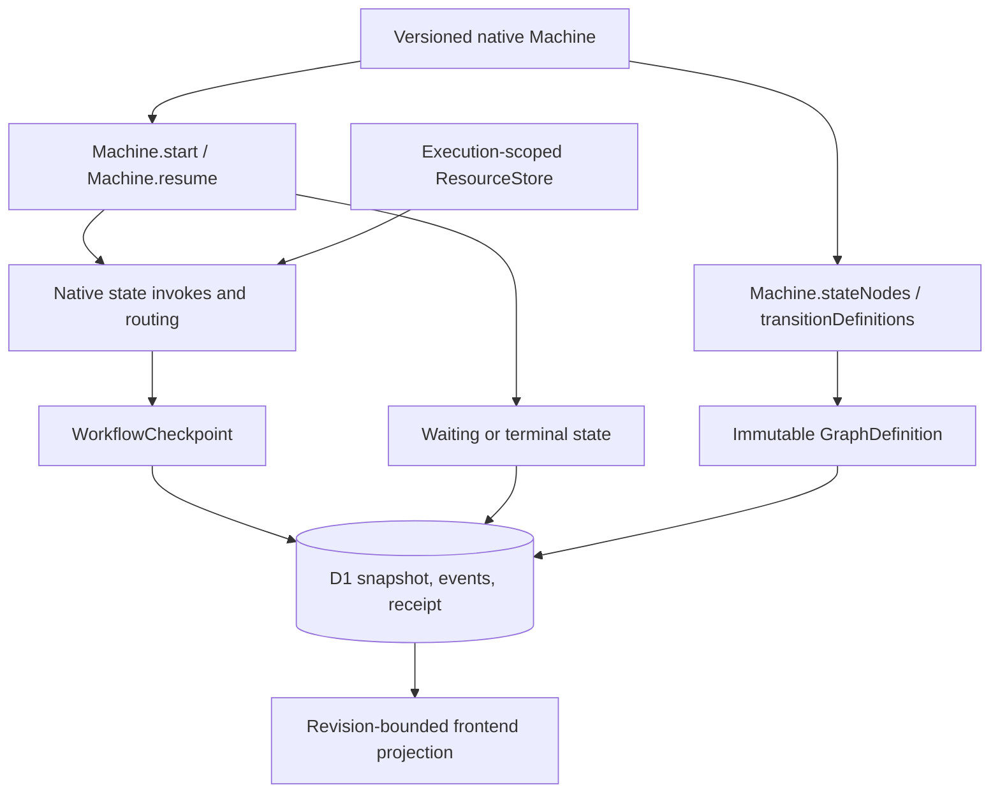
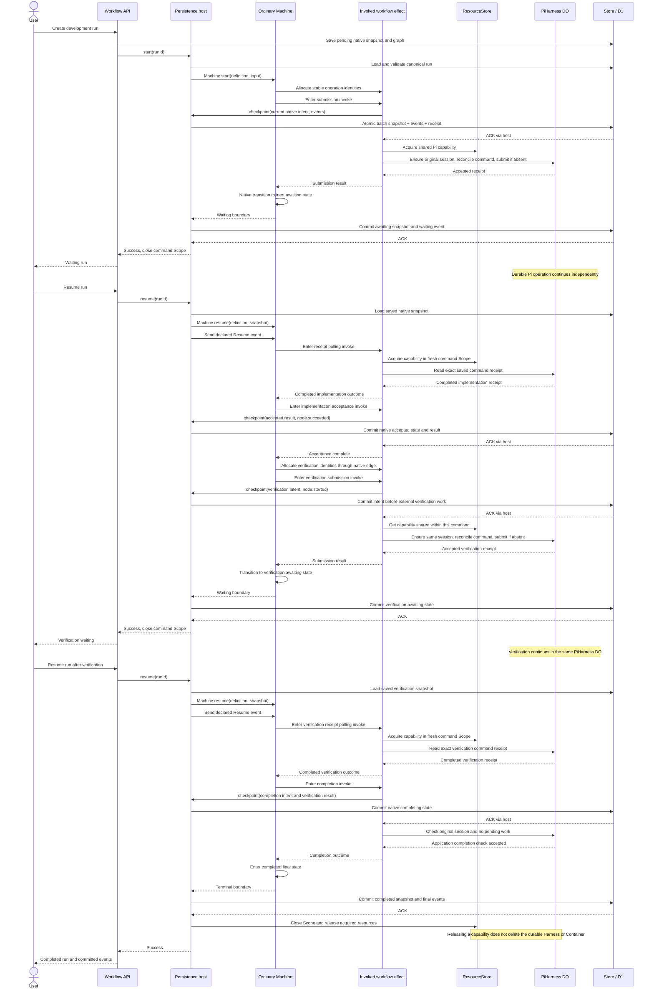

# Workflow graphs

This document explains workflow execution, persistence, and graph display.
See [architecture](architecture.md), [database workflow](database.md), [RPC boundaries](rpc-boundaries.md), and [sandbox setup](development-sandbox.md) for the surrounding contracts.

## Execution ownership

Flowdeck uses ordinary `Machine` from [`@typeonce/effect-machine`](https://github.com/typeonce-dev/effect-machine), version `0.46.0` with Effect `4.0.6`.
This community package is not an Effect core module or Cloudflare Workflows.
Use its [version-matched guide](https://effect-machine.typeonce.dev/agent-guide/) and installed API types.

**The native Machine owns progression and invokes all workflow business effects.**
Native event transitions, `invoke.onDone`, and branch resolvers select the next state.
Entering that state starts its native invoke automatically.
There is no task map, application transition interpreter, or recursive task execution loop.
Both demo versions and the development workflow use this execution model.

In this installed version, `entry` and `exit` actions run synchronously and return `undefined`, not an asynchronous `Effect` or `Promise` to await.
Use them for synchronous lifecycle actions and queued machine commands.
Use `invoke` for asynchronous work whose completion drives a native `onDone` transition, including Pi resource acquisition, operation submission, receipt checks, and persistence checkpoints.
Branch resolvers select the declared next state synchronously from that result.
Do not start detached asynchronous work from an action and move its completion handling into an external executor.

| Component                                                       | Responsibility                                                                                                         |
| --------------------------------------------------------------- | ---------------------------------------------------------------------------------------------------------------------- |
| Versioned native Machine                                        | Define states, asynchronous effects, routing, waiting, and business failure.                                           |
| [Persistence host](../src/features/workflow/managed-runtime.ts) | Load canonical D1 state, validate identity, open native execution, commit snapshots, and wait for ACK before replying. |
| [ResourceStore](../src/features/workflow/resource-store.ts)     | Share typed volatile resources within one execution Scope.                                                             |
| [Graph projection](../src/features/workflow/graph.ts)           | Derive visible nodes and edges from native introspection without running effects or resolvers.                         |
| Store / D1                                                      | Atomically commit snapshots, ordered events, revision checks, and commit receipts.                                     |
| PiHarness Durable Object                                        | Persist conversations and external operation receipts and manage Pi execution.                                         |
| Frontend                                                        | Display the stored graph and committed events, without executing nodes.                                                |

`ClusterMachine` is not the workflow runtime.
The installed ClusterMachine rejects process-local activities such as `invoke` with `UnsupportedProcessLocal`.
The independent [Cluster storage adapter](cluster-machine-storage.md) remains available for supported data-only cluster machines.
It is not a prerequisite for the workflows described here.

## One native definition, two projections

Visible nodes have `title` and `description` annotations, with `description` equal to `task` or `checkpoint`.
Nested implementation states project to their annotated business ancestor.
Unannotated allocation states between visible nodes are traversed statically when projecting edges.
Alternative native transitions between the same visible pair share one displayed edge with combined labels.
Projection never evaluates guards, invokes, or branch resolvers.
Unannotated terminal states do not appear as task nodes.

The transport model remains `GraphDefinition { graphId, schemaVersion: 1, nodes, edges }`.
Workflow SemVer selects executable behavior, graph identity selects immutable display data, and the library controls its encoded snapshot version.
These versions are distinct.
The application has not been deployed, so this implementation does not provide compatibility codecs or migration paths for earlier development snapshots.
The two demo versions demonstrate executable version selection, not compatibility with the removed execution model.
Persisting a workflow version does not archive executable code: that version's definition and codecs must remain deployed.

## Start and restoration

Preparation validates input and uses the native pure initial plan to encode the pending snapshot.
It does not execute business work.
Run creation saves that snapshot, the selected version, and its graph before dispatching `start`.

Each command reloads the canonical run from D1.
A pending run executes through `Machine.start`.
An existing running or waiting checkpoint restores through `Machine.resume` with the decoded native snapshot.
There is no separate restore interpreter or duplicate application-owned node position.
Workflow ID, version, graph ID, native snapshot, and derived run status must agree before execution begins.
Terminal runs reject further execution.

Native resume restores logical state, not fibers, suspended continuations, arbitrary resources, or an instruction offset inside an invoke.
It can restart an active invoke.
Therefore each workflow must make its external effects recoverable from persisted identities and authoritative receipts.
Do not claim that native resume makes arbitrary effects exactly-once.

The request-scoped runtime runs until the workflow reaches an inert waiting or terminal state.
After the boundary snapshot is acknowledged, the command Scope closes.
An accepted Pi operation can continue in its PiHarness Durable Object after that Scope closes.
A repeated `start` does not send a Resume event to a waiting machine.
Explicit `resume` restores the machine and sends its declared `Resume` event.
The workflow itself decides what that event means.

## Durable State and volatile resources

The persisted envelope contains only `schemaVersion`, workflow `version`, and the library-encoded `machine` snapshot.
It does not duplicate the native node position or domain context.
A native state can carry validated repository data, stable execution/command identities, and durable results.
It must not contain a PiHarness instance, client, function, or other non-serializable runtime value.

`ResourceStore` is separate from the durable workflow `Store`.
It uses typed Effect `Context.Key` values and lazy `getOrTryInit` effects, following the Rust workflow-resources design.
Same-key callers share one successful initialization, including concurrent callers.
Different keys initialize independently.
Failed or interrupted acquisition is not cached, and resources acquired by that failed attempt are released immediately.
Successful resources are released with their owning execution Scope.
Use globally unique native Context key identities.

Every command gets a new ResourceStore shared across all its native invokes.
After disposal and resume, resources are acquired again as needed.
The development workflow caches the capability to its DO-owned PiHarness, not the conversation or operation state.
The native SDK descriptor can be installed at activation, but workflow-owned acquisition and use occur inside native invokes.
This does not add per-node harness startup or multiple sessions to the current workflow.

## Checkpoint and ACK boundary

An invoked effect requests persistence through `WorkflowCheckpoint` before a recoverability-sensitive external action.
That capability reads the current native snapshot and writes it through the shared Store.
It does not select the next state or execute another node.
Native transitions continue after the invoke effect returns.
A waiting or terminal boundary is also committed before the command replies.
An unchanged native snapshot and status produce no new revision or lifecycle event.

A checkpoint stores how to recover.
The native Machine performs progression.
Neither a lifecycle observation hook nor a notification is an execution engine.

Store writes use one native D1 batch for the receipt, revision-checked run snapshot, and complete event batch.
Exact duplicate commit commands return their original ACK.
A revision conflict or changed duplicate is rejected.
This transaction does not include a PiHarness DO operation.
Recovery reconciles the stable command ID with that DO rather than promising a cross-service transaction.

Persistence and infrastructure failures propagate without becoming a committed business failure.
A business failure is an explicit native state selected by workflow logic.
`LifecycleHook.afterCommit` observes successful commits only and is best effort.
A failed hook is logged and cannot undo canonical state.
There is no hook outbox or guaranteed callback replay.

## Workflow-specific behavior

### Demo versions

Versions `1.0.0` and `2.0.0` declare separate native machines.
Both project `prepare` → `approval` → `publish`.
Preparation produces `draft:v1` or `draft:v2:reviewed`, respectively.
The approval state has no running invoke and waits for the explicit native Resume event.
Publishing is then started automatically by its native edge.
The demo's pure bodies can safely run again after a failed boundary commit.
Resume has no separate approval payload, rejection policy, or approver record in the current public API.

### Pi development

The development machine owns initialization, submission, polling, implementation acceptance, verification, and completion invokes.
Its nested native states preserve execution and command identities without a separate PiPhase dispatcher.
Submission saves the intent before calling the sandbox.
It checks an exact existing command receipt before submitting.
Only authoritative absence while the intent remains unacknowledged permits submission with that same command ID.

An awaiting state accepts Resume and polls the exact receipt.
A still-running receipt returns to the same awaiting state without another submission, event, or revision.
A missing acknowledged receipt fails closed instead of resubmitting.
Completed implementation transitions through its acceptance checkpoint to verification in the same native runtime.
Completed verification saves a completion intent before checking that the original session has no pending work.
The sandbox completion operation is an application completion check, not a claim that PiHarness exposes a session-finalization API.
Neither completion nor runtime Scope disposal deletes the Container.

PiHarness owns conversation, operation, and Container recovery.
D1 does not serialize those resources or recreate a missing workspace.
See [retention](development-workflow-retention.md) for the independent lease policy.
Retention callbacks do not choose or advance workflow nodes.

## Registration and frontend

Each workflow supplies a neutral catalog `summary` and `prepare(input)` returning its graph and encoded initial snapshot.
[Registration](../src/workers/workflow/features/registration.ts) binds these definitions to fixed workflow service bindings.
The integration service routes mechanically from that registry.
Control uses only the integration Worker binding, and each workflow entry routes to its run Durable Object.

The frontend reads the graph saved with the run and events bounded by its current revision.
It does not regenerate a historical run's graph from the current catalog.
Event sequence determines displayed node state.
A displayed traversed edge is inferred from source success and target start, not a separately persisted transition receipt.
Selection and refresh do not execute workflow effects.

## Supported boundaries and evidence

This integration supports the current sequential workflows with one recoverable active leaf and inert command boundaries.
It does not promise durable timers, parallel independent invokes, child-machine restoration, arbitrary event injection, or general external exactly-once execution.
In particular, restoring a child Machine is not equivalent to restoring an instruction offset inside its invoke.
Expand these contracts only with explicit persistence semantics and public-path tests.

| Maintained tests                                                                      | Observable contract                                                                                                          |
| ------------------------------------------------------------------------------------- | ---------------------------------------------------------------------------------------------------------------------------- |
| [Native graph tests](../src/features/workflow/graph.test.ts)                          | Native automatic invoke progression matches displayed edges, including nested and hidden allocation states.                  |
| [Persistence host tests](../src/features/workflow/managed-runtime.test.ts)            | Native start/resume selection, ACK ordering, unchanged polls, error identity, and post-ACK hooks.                            |
| [ResourceStore tests](../src/features/workflow/resource-store.test.ts)                | Typed volatile sharing, concurrent acquisition, retry, immediate failed-attempt cleanup, and fresh-scope isolation.          |
| [D1 and public workflow tests](../src/features/workflow/services/d1-store.test.ts)    | Actual D1 atomicity, cold restoration, both versions, HTTP routes, commit conflicts, and RPC failure recovery.               |
| [Development tests](../src/workers/development-workflow/features/development.test.ts) | Actual D1 checkpoints with sandbox-boundary controls for receipt recovery, no duplicate submission, and workflow completion. |
| [Cluster storage tests](../src/features/cluster/d1-storage.test.ts)                   | Independent data-only Cluster storage through official Entity.client and actual local D1.                                    |

Sandbox boundary controls do not establish deployed Pi inference or real Container acceptance.
Local D1 and official local Cluster tests do not establish distributed runner transport or deployed storage behavior.
Report those limits separately from the behavior exercised by each test.
