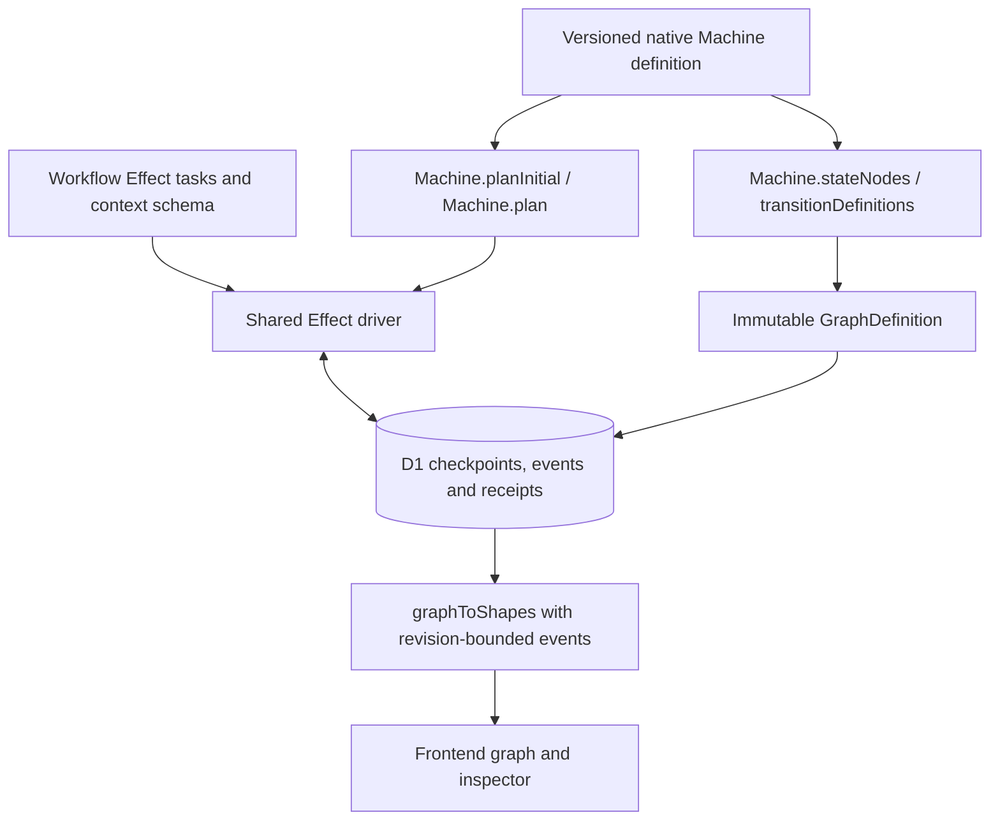
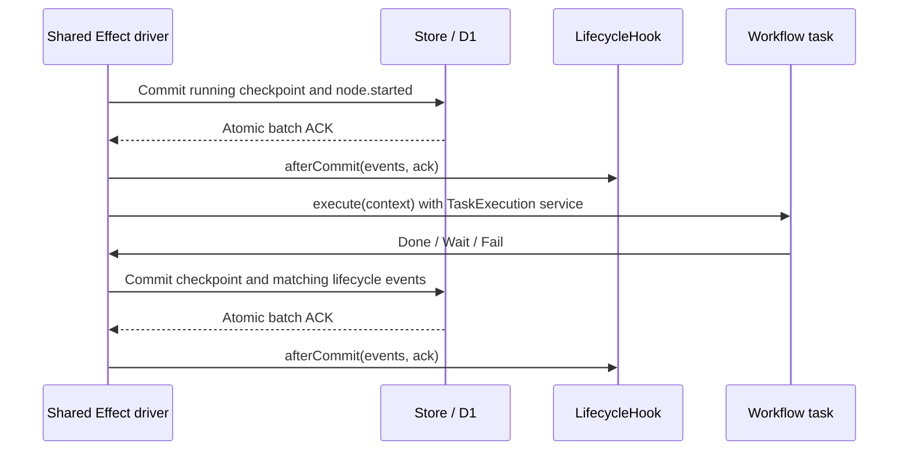
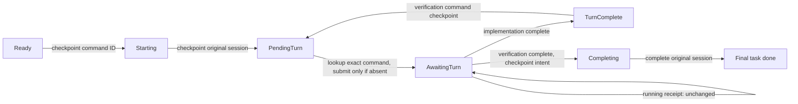

# Workflow graphs

This document explains how contributors define, execute, persist, and display workflows.
It describes the implementation, not a proposed graph interpreter.
See [architecture](architecture.md), [database workflow](database.md), and [RPC boundaries](rpc-boundaries.md) for the surrounding resource, storage, and transport contracts.

## Overview

**Flowdeck uses one state-machine definition for execution topology and its persisted visual graph.**
The selected library is `@typeonce/effect-machine`.
The shared [planner adapter](../src/features/workflow/machine.ts) derives `GraphDefinition` from the library's compiled topology and delegates transition planning to that library.
The shared [Effect driver](../src/features/workflow/driver.ts) integrates task execution, checkpoint commits, lifecycle events, and observation hooks.
Workflow modules supply versioned machine definitions, domain context schemas, and task effects.
They do not maintain a second visual edge list or a workflow-specific copy of the common lifecycle driver.
Here, a native machine is the library-owned model, not a Cloudflare Workflows resource.

| Structure                 | Responsibility                                                                                          |
| ------------------------- | ------------------------------------------------------------------------------------------------------- |
| Native machine definition | Declare state topology, transitions, and annotations once.                                              |
| Driver checkpoint         | Retain the native logical snapshot, current task position, lifecycle state, and encoded domain context. |
| Workflow task adapter     | Perform Effect work and reconcile external operations using its own durable context.                    |
| `GraphDefinition`         | Retain the derived visible graph associated with a run.                                                 |
| `Shapes`                  | Combine that graph with committed events for display, without executing workflow work.                  |

The neutral catalog/registration contract in [workflow-definition.ts](../src/features/workflow/services/workflow-definition.ts) is distinct from the executable driver `Definition`.

## Which Machine implementation is adopted?

**Flowdeck selects the separately published [`@typeonce/effect-machine`](https://github.com/typeonce-dev/effect-machine) library, not a handwritten state-transition interpreter.**
The installed package is `0.46.0`, with peer dependency `effect: ^4.0.0`.
Effect core `4.0.6` does not itself export the earlier experimental Machine module.
This is adoption of the community package, not an official Effect core Machine integration, an XState execution path, or native Cloudflare Workflows orchestration.

The [official Agent Guide](https://effect-machine.typeonce.dev/agent-guide/) defines the Schema-first machine and Effect-service conventions used here.
The version-matched guide bundled with `@typeonce/effect-machine@0.46.0`, its [package documentation](https://github.com/typeonce-dev/effect-machine/blob/main/packages/effect-machine/README.md), and [API source](https://github.com/typeonce-dev/effect-machine/blob/main/packages/effect-machine/src/Machine.ts) distinguish pure planning, logical snapshots, and the managed local runtime.
Flowdeck uses `Machine.planInitial`, `Machine.plan`, `Machine.encodeSnapshot`, and `Machine.decodeSnapshot`.
Planning computes logical transitions without executing command effects.
`Machine.stateNodes` and `Machine.transitionDefinitions` expose declared topology without running transition resolvers to discover edges.
Flowdeck integrates this planning boundary with D1 and Effect tasks rather than making a live `MachineRef` canonical.
A logical snapshot does not preserve fibers, subscriptions, external resources, or historical executable code.
The package is pre-1.0, so its capabilities do not automatically become supported capabilities of Flowdeck's adapter.

## One definition, two projections



The [adapter](../src/features/workflow/machine.ts) creates graph nodes from atomic state paths and their `title` and `description` annotations.
The annotation description supplies the visible `task` or `checkpoint` kind.
Edges come from declared transition branches whose destinations are visible tasks.
Named branches enumerate possible destinations, and a synchronous library resolver selects among their bound constructors.
The [adapter tests](../src/features/workflow/machine.test.ts) demonstrate conditional routing from task context while projecting both declared alternatives.
Final machine states do not become visible task nodes.
The library chooses the transition when the driver submits a `Done` event carrying encoded task context.
Remaining `Match` expressions handle the shared lifecycle envelope or task-owned recovery phases, not a second next-node transition table.
Neither the frontend nor `graphToShapes` executes transitions.

The [graph transport schema](../src/features/workflow/domain/model.ts) remains deliberately small:

| Contract          | Fields                                                  |
| ----------------- | ------------------------------------------------------- |
| `GraphDefinition` | `graphId`, literal `schemaVersion: 1`, `nodes`, `edges` |
| `GraphNode`       | `nodeId`, `label`, `kind: 'task' \| 'checkpoint'`       |
| `GraphEdge`       | `edgeId`, `source`, `target`, `label`                   |

Workflow, graph, node, and edge IDs use the caller-defined [identity schemas](../src/features/workflow/domain/identity.ts).
The graph's `schemaVersion` describes its wire shape, the workflow `SemVer` selects its implementation, and the library controls its own encoded-snapshot format.
These versions are not interchangeable.
A node ID names a definition, while execution IDs and positive attempt numbers identify executions in lifecycle events.
A `checkpoint` display kind does not suspend work by itself.
Approval and waiting must be implemented by the corresponding task.

### Versioned definitions

The demo's [version-1.ts](../src/workers/demo-workflow/features/version-1.ts) and [version-2.ts](../src/workers/demo-workflow/features/version-2.ts) declare separate native machines and executable definitions.
Version `1.0.0` uses graph ID `demo-1_0_0-graph-1` and produces `draft:v1`.
Version `2.0.0` uses graph ID `demo-2_0_0-graph-1` and produces `draft:v2:reviewed`.
They share the `prepare` → `approval` → `publish` topology but use different labels and preparation effects.
[demo.ts](../src/workers/demo-workflow/features/demo.ts) selects the implementation at the version boundary and constructs the shared driver for each retained version.
The reusable [demo tasks](../src/workers/demo-workflow/features/node.ts) contain approval and publishing behavior, not lifecycle event batches or a transition interpreter.

The Pi workflow's [native declaration](../src/workers/development-workflow/features/development-machine.ts) defines `implement` → `verify` → final completion.
[development.ts](../src/workers/development-workflow/features/development.ts) wraps that machine, exposes its derived graph, and constructs the shared driver with Pi-owned tasks.
Its visible graph is `jcode-development-1_0_0-graph-1` for version `1.0.0`.
Both visible nodes are tasks, although both can wait for external turn completion.
Waiting is not restricted to nodes displayed as checkpoints.

## Driver and task contract

[`makeDefinition`](../src/features/workflow/driver.ts) captures the context codec and initial native plan once for a versioned definition.
The definition combines workflow identity, version, the planner adapter, the context schema, and an Effect that constructs the task map.
Preparation supplies the run-specific initial context to `initialMachineSnapshot(definition, context)`.
`makeDriver` captures Store, task services, the lifecycle hook, and identity generators when the runtime service is built.
Worker and Durable Object roots provide the complete stable runtime dependencies rather than reacquiring them inside each node operation.

A task exposes `execute(context)` and obtains the invocation-scoped `TaskExecution` service with `yield* TaskExecution`.
That service supplies the run ID, execution ID, operation (`start` or `resume`), and `checkpoint(nextContext)`.
The driver provides it only around the current task invocation because its checkpoint capability closes over that invocation's revision and checkpoint references.
Stable Store, task dependencies, and hooks remain captured when the driver is constructed.
The service accepts checkpoint context as `unknown`, and the definition's captured context schema validates it before encoding or persistence.
Invalid checkpoint context fails with `InvalidSnapshot` rather than committing a malformed checkpoint.
The task returns one of these outcomes:

| Outcome     | Driver behavior                                                                                                                |
| ----------- | ------------------------------------------------------------------------------------------------------------------------------ |
| `Done`      | Plan the library's `Done` transition, commit node success and the next task start or run completion, then drive the next task. |
| `Wait`      | Commit waiting context and `run.waiting`, then return without retaining a suspended continuation.                              |
| `Fail`      | Commit the explicit failure context, node failure, and run failure.                                                            |
| `Unchanged` | Return without a checkpoint or event write, as used when a polled Pi turn is still running.                                    |

An Effect failure is not the same as an explicit `Fail` outcome.
Infrastructure errors, including task checkpoint write failures, propagate rather than being translated into a committed business failure.
Recovery then starts from the last committed checkpoint.
Tasks still own the decision whether a particular external failure is retryable, terminal, or unsafe to resubmit.

The shared checkpoint union is `Ready`, `Running`, `Waiting`, `Completed`, or `Failed`.
It stores the workflow version, task position, library-encoded logical snapshot, and encoded domain context.
Active and failed checkpoints also carry execution identity and attempt.
`restoreMachineSnapshot` validates workflow identity, version, graph, status, context, and agreement between the native snapshot and task position before execution.
Every `start` or `resume` call reloads canonical D1 state.
Restoring `Running` reuses committed execution identity rather than emitting another node start.
`Completed` and `Failed` reject further execution.
This undeployed change replaces the earlier workflow-specific checkpoint envelopes without compatibility decoding.
The demo's task-start intent is committed separately from the approval wait, so its waiting checkpoint has revision 3 and its completed checkpoint has revision 5.

### Lifecycle commits and hooks

The driver generates node and run lifecycle events rather than asking each task to construct event batches.
A new task's running intent and `node.started` commit before the task body executes.
A successful transition commits source success and the following task's start together.
A task-local context checkpoint uses the same shared commit path even when it has no node event.



`LifecycleHook.afterCommit` is a registered Effect service with a no-op default.
It runs after the D1 acknowledgment, and a hook failure is logged without rolling back the canonical commit.
It is best-effort observation, not a transactional participant or durable callback delivery mechanism.
A crash after commit can occur before a hook runs, and this integration has no hook outbox or replay guarantee.
Do not put indispensable workflow progression or irreversible business work in an observational hook.

## Manual approval and explicit resume

The demo approval task returns `Wait` for operation `start` and `Done` with `{ approved: true }` for operation `resume`.
Its [actual task implementation](../src/workers/demo-workflow/features/node.ts) uses the shared outcome constructors:

```ts
const outcomes = taskResult<DemoContext>()
export const approvalTask: Task<DemoContext> = {
  execute: (context) =>
    Effect.gen(function* () {
      const control = yield* TaskExecution
      return control.operation === 'resume'
        ? outcomes.Done({ context, payload: { approved: true } })
        : outcomes.Wait({ context })
    }),
}
```

The driver persists the wait, including its execution identity, rather than keeping a fiber suspended.
A repeated `start` leaves a waiting run alone.
An explicit resume invokes the waiting task and records `run.resumed` when progress is committed.
Publishing then executes through the same lifecycle driver as preparation.
The demo bodies are pure, which makes interrupted task retry safe for this example.

The current [executor contract](../src/features/workflow/services/workflow-definition.ts) accepts only `resume(runId)`.
The demo has no separate approval decision payload, rejection path, approver record, or graph-declared approval policy.
Its manual approval is the approval task's interpretation of explicit resume within the application's existing authorization boundary.
A resume call is not a general event injection API, and no exactly-once delivery guarantee is implied.

## Pi task phases and recovery

[pi-task.ts](../src/workers/development-workflow/features/pi-task.ts) owns external-operation reconciliation, while the common driver owns graph position and lifecycle persistence.
The typed `DevelopmentContext` includes the fixed `pi-harness` runtime, repository, task, version, and a `PiPhase` union.
The phases are `Ready`, `Starting`, `PendingTurn`, `AwaitingTurn`, `Completing`, and `TurnComplete`.
These phases are domain context inside the common checkpoint, not another visible graph or a replacement common execution engine.



The task checkpoints a command ID before creating or reconnecting the session, and checkpoints session identity before submission.
`PendingTurn` queries the exact command first.
Only authoritative absence while that submission remains unacknowledged permits resubmission of the same command.
An accepted turn produces `Wait` with `AwaitingTurn` context.
Explicit resume polls the receipt, and a still-running receipt returns `Unchanged` without new events, revision changes, or another submission.
An acknowledged turn whose receipt disappears fails closed instead of being automatically resubmitted.

Implementation completion returns `Done` with `TurnComplete` context, allowing the native machine to select `verify`.
The verification task checkpoints a new command in the original session before submission.
After verification finishes, it checkpoints `Completing` before asking the sandbox to complete that session.
That intent supports retrying completion if its acknowledgment or the final D1 write fails.
Session identity and receipt checks remain inside the Pi adapter, not the common driver.
Completing a session does not destroy its Container or workspace.

The official PiHarness owns durable conversation and operation state in Durable Object storage, while D1 owns workflow checkpoints and events.
Reconstruction does not restore a lost workspace or manufacture a missing original session.
See [sandbox setup and acceptance limits](development-sandbox.md) and [workspace retention](development-workflow-retention.md) for those external-runtime constraints.
Retention jobs do not advance workflow nodes or replace explicit resume.

## Registration, version persistence, and graph identity

Each registered workflow supplies a catalog `summary` and `prepare(input)` that validates workflow-specific input and returns its derived graph with an encoded initial checkpoint.
The demo [definition](../src/workers/demo-workflow/features/definition.ts) and Pi [definition](../src/workers/development-workflow/features/definition.ts) implement that neutral contract independently.
[registration.ts](../src/workers/workflow/features/registration.ts) combines installed definitions with static execution bindings.
The [integration service](../src/workers/workflow/features/workflow.ts) performs registry lookup without workflow-specific execution branches.
Control retains its single integration Worker binding, and each workflow entry resolves one logical run Durable Object by run ID.

Preparation completes before run ID generation or persistence.
Creation stores the requested version, graph reference, pending status, and initial checkpoint before calling `start`.
A failed start call therefore leaves a pending run for explicit recovery.
[D1Store](../src/features/workflow/services/d1-store.ts), [schema constraints](../schema/schema.hcl), and [identity and immutability triggers](../schema/triggers.hcl) retain the graph JSON and workflow-version association.
Graph IDs are explicit identifiers, not content hashes.
Identical reuse is allowed, but reusing a graph ID with different content is rejected.
Change the graph ID and workflow version when the graph contract changes.

Checkpoint writes atomically persist the receipt, run state, snapshot, and ordered event batch before acknowledgment.
Exact duplicate commit commands return their original acknowledgment, while changed duplicate commands and revision conflicts are rejected.
These storage guarantees do not make arbitrary external task effects exactly-once.
Persisting a version also does not archive its executable code.
Existing runs still require the pinned implementation and compatible context and native snapshot codecs to remain deployed.

## Frontend graph projection

The integration service reads the run's stored graph and events through the run revision, then invokes [graphToShapes](../src/features/workflow/domain/projection.ts).
It does not regenerate an old run's graph from the current catalog.
Projection uses durable event sequence order rather than wall-clock timestamp or delivery order.
The latest applicable node event determines visual state, with `idle` as the default.
Node positions follow graph array order in a single horizontal row, not a dependency-aware DAG layout.

An edge is marked traversed when any source success and any target start exist in the event set.
There is no persisted edge-traversal event, temporal pairing, or execution-pair matching in that inference.
A traversal indicator can remain set while a later source attempt is active and is not proof of a particular transition.
The [graph and inspector](../src/workers/frontend/features/graph.tsx) render committed state and event payloads.
[Presentation helpers](../src/workers/frontend/features/presentation.ts) keep selection independent from execution state and support bounded keyboard navigation by definition order.
Selection and refresh do not execute tasks.
The [dashboard](../src/workers/frontend/features/dashboard.tsx) invokes the resume operation for waiting runs or explicit recovery of pending/running runs.

## Authoring and limits

1. Define the workflow's ID, supported versions, validated input, and catalog descriptors in its feature module.
2. Declare native states, transitions, and annotations once, then derive the graph through `makeMachine`.
3. Build a versioned `makeDefinition` with its context schema and tasks, and use `initialMachineSnapshot` when preparing a run.
4. Implement `execute(context)` and obtain `TaskExecution` for invocation metadata and recoverable `checkpoint` writes, then return `Done`, `Wait`, `Fail`, or `Unchanged`.
5. Construct the driver with the complete runtime Layer graph, expose the fixed start/resume binding, and register the definition at integration composition.
6. Test topology projection, version pinning, lifecycle ordering, hooks, explicit resume, conflicts, and cold recovery with the task adapter's reconciliation policy.

The current driver maintains one active task position and drives tasks sequentially.
The adapter accepts only flat, data-only machines with explicit-target `Done` transitions.
It rejects compound or parallel state nodes, autonomous transitions, targetless `none` or `update` branches, and duplicate source-target pairs, including differently named branches with the same destination.
These restrictions prevent task skipping, non-advancing completion loops, and ambiguous graph edge identities.
It also rejects native snapshots with more than one active leaf, startup or transition plans containing runtime commands, and task completion that selects no native transition.
Managed activities and other event protocols are excluded by the adapter's public type signature.
Do not infer support for general parallel execution, child-machine hosting, arbitrary managed commands, durable timers, or custom event injection from the upstream library's broader statechart features.
Pure planning does not execute native machine command effects, and this adapter is not a replacement for the upstream managed runtime's full execution protocol.
No hook outbox, generic external replay, automatic workspace-loss recovery, or exactly-once external effects are promised.

## Evidence and regression tests

These maintained tests provide the behavior checks associated with this design.
Source inspection and test doubles do not establish real Container, provider, or deployment acceptance.

| Evidence                                                                                        | Behavior covered                                                                                                                                                                                                                         |
| ----------------------------------------------------------------------------------------------- | ---------------------------------------------------------------------------------------------------------------------------------------------------------------------------------------------------------------------------------------- |
| [Native adapter tests](../src/features/workflow/machine.test.ts)                                | Declared conditional edges, library-selected branches after snapshot decode, malformed native paths, missing transitions, and rejection of duplicate edges, compound/parallel machines, autonomous transitions, and targetless branches. |
| [Shared driver tests](../src/features/workflow/driver.test.ts)                                  | Start-before-task ACK ordering, invocation-scoped checkpoints and their validation, cold restoration, unchanged resume, propagated infrastructure errors, explicit business failure, and defective post-ACK hooks.                       |
| [Demo task tests](../src/workers/demo-workflow/features/node.test.ts)                           | Explicit approval waiting/resume and version-specific publication output.                                                                                                                                                                |
| [Demo definition tests](../src/workers/demo-workflow/features/definition.test.ts)               | Versioned graphs, initial checkpoints, strict input, and restore boundaries.                                                                                                                                                             |
| [D1 store and recovery tests](../src/features/workflow/services/d1-store.test.ts)               | Immutable graphs, version persistence, atomic ACK, duplicate commands, conflicts, and cold restoration.                                                                                                                                  |
| [Development definition tests](../src/workers/development-workflow/features/definition.test.ts) | Derived graph preparation, validated Pi context, and strict restore boundaries.                                                                                                                                                          |
| [Development execution tests](../src/workers/development-workflow/features/development.test.ts) | Persist-before-submit, unchanged polling, same-session verification, receipt loss, and interrupted checkpoint recovery.                                                                                                                  |
| [Projection tests](../src/features/workflow/domain/projection.test.ts)                          | Durable sequence order and traversal retained across later attempts.                                                                                                                                                                     |
| [Presentation tests](../src/workers/frontend/features/presentation.test.ts)                     | Execution inspection, recovery actions, and keyboard navigation.                                                                                                                                                                         |
